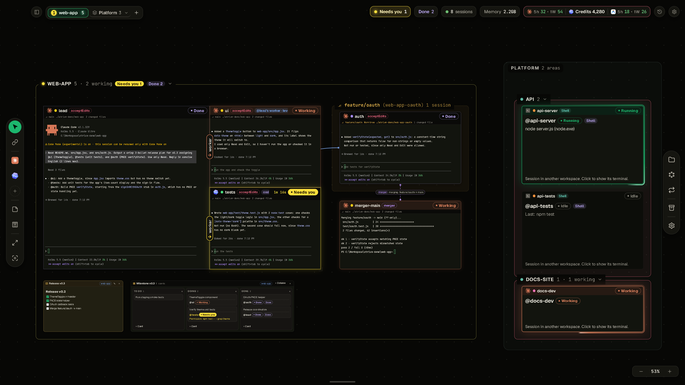
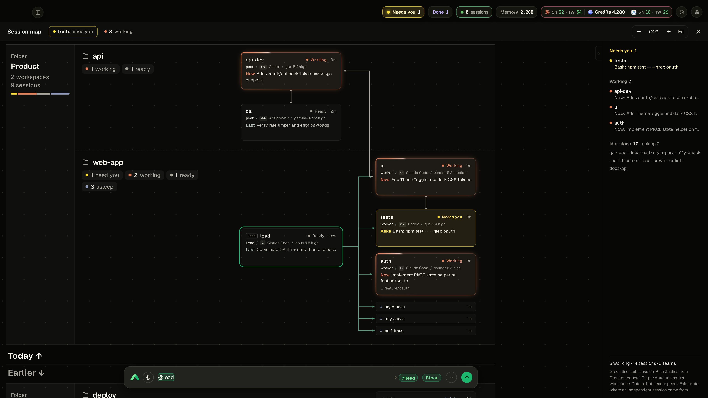
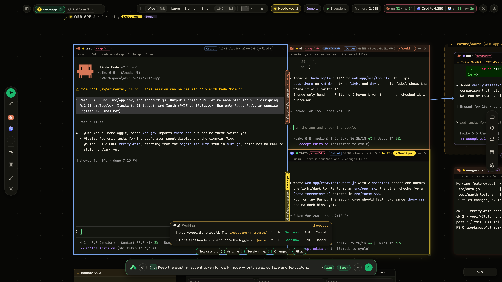
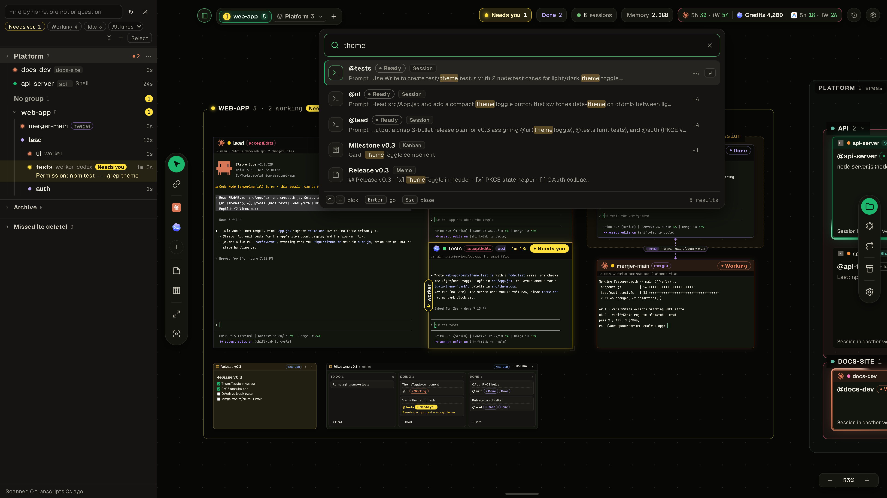
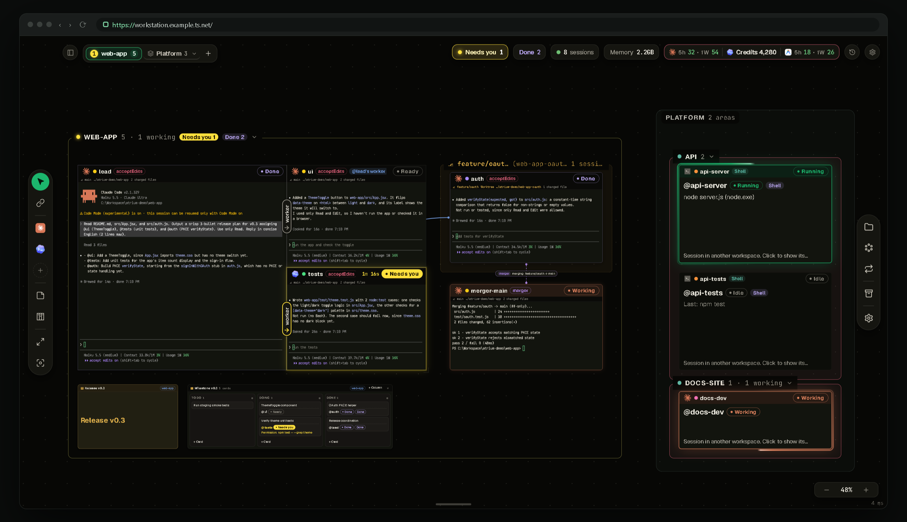
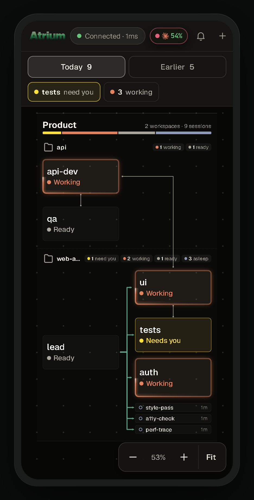
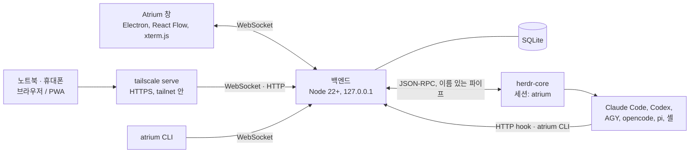

<p align="center">
  
</p>

<p align="center">
  <b>CLI 코딩 에이전트를 위한 무한 캔버스.</b><br>
  Claude Code, Codex, Antigravity, opencode, pi, 일반 셸을 한 보드에 띄워 두고 누가 일하는지, 누가 답을 기다리는지 한눈에 보며 창을 오가지 않고 협업합니다.
</p>

<p align="center">
  
  
  
  
</p>

<p align="center">
  <a href="README.md">English</a> · <b>한국어</b>
</p>



## 왜 Atrium인가요

코딩 에이전트를 다섯 개, 스무 개씩 동시에 돌리면 탭과 사이드바 목록은 금세 한계에 부딪힙니다. 활동할 때마다 목록 순서가 뒤바뀌고, 백그라운드 세션은 가려지고, 권한 확인을 기다리는 세션 하나를 놓치기 쉽습니다.

Atrium은 모든 저장소와 실제 터미널을 하나의 무한 캔버스에 고정된 자리로 배치합니다. 일하는 에이전트는 주황, 답을 기다리는 세션은 노랑으로 표시되며, 모든 터미널은 앱 밖의 [herdr-core](https://github.com/herdrdev/herdr-core)에서 돌아갑니다. 창을 닫거나 백엔드를 재시작하거나 Atrium을 업데이트해도 세션은 끊기지 않고 다시 붙습니다.

## 둘러보기

### 모든 저장소를 하나의 보드에서

저장소마다 독립된 영역이 생기고, 사용 중인 Git 워크트리는 그 안의 노란 상자로 표시됩니다. 가까이 확대하면 직접 입력할 수 있는 진짜 `xterm.js` 터미널이고, 멀리 축소하면 상태·마지막 요청·응답을 담은 요약 카드로 바뀝니다.

위쪽 막대는 모든 저장소를 가로질러 핵심 상태만 보여 줍니다.

- **응답 필요**(`N`): 가장 오래 기다린 질문이나 권한 요청으로 바로 이동합니다.
- **작업 완료**: 아직 확인하지 않은 상위 세션의 끝난 턴을 모으고 **모두 읽기**로 한 번에 비웁니다.
- **구독 사용량**: 로컬 출처에서 Claude, Codex(남은 크레딧 포함), Antigravity의 한도 창 사용률을 보여 줍니다.
- **메모리·CPU**: 세션별·전체 사용량을 표시합니다. 쉬는 저장소와 쉬는 세션은 자동으로 절전되어 메모리를 아끼고, 클릭하거나 메시지를 보내면 같은 대화·모델·노력 수준으로 깨어납니다.

마크다운 메모와 세션에 연결된 칸반 보드도 터미널 옆에 바로 둘 수 있습니다.

### 세션 맵 (`Tab`)



`Tab`을 누르면 캔버스에서 **세션 맵**으로 전환됩니다. 폴더와 저장소별로 **오늘**과 **이전**을 나누어 전체 세션의 관계도를 무한 캔버스로 보여 줍니다.

- Claude Code, Codex, Antigravity, pi 세션의 상위–하위 나무와 동료 사슬을 선 겹침 없이 한눈에 추적합니다.
- 일하는 카드는 테두리를 따라 도는 빛으로 멀리서도 바로 보이고, 절전된 워커는 얇은 줄로 접힙니다.
- 카드를 클릭하면 아래 명령줄에 `@태그`가 붙어 맵을 닫지 않고도 바로 지시를 보낼 수 있고, 더블클릭하면 보드의 해당 터미널로 이동합니다.

### 창 그룹, 전달 대기열, 스티어링



- **창 그룹.** `Ctrl`을 누른 채 터미널을 다른 창 가장자리로 끌어 tmux처럼 분할 배치합니다. 세션 수(2~6개 이상)에 맞는 배치 틀을 고를 수 있고, 그룹 안 연결선은 터미널을 가로지르지 않고 분할선 위 다리로 표시됩니다.
- **세션별 전달 대기열.** 명령줄(`Ctrl+K` 또는 `↓`)에서 `@이름`이나 `@all`로 지시를 보냅니다. 에이전트가 일하는 중이면 대기열에 쌓여 턴이 끝난 뒤 차례대로 들어가며, 대기 중인 글은 순서 변경·수정·취소가 됩니다.
- **턴 도중 스티어링.** 일하는 중인 Claude Code 세션에 방향을 바로 보태야 하면 **스티어링**을 켜거나 `Ctrl+Enter`로 전송해 현재 턴 안에 즉시 넣습니다.
- **응답은 터미널에서.** 질문이나 권한 확인을 별도 팝업으로 감싸지 않습니다. 노란 세션으로 이동(`N`)해 실제 터미널에서 바로 답합니다.

### 큰 보드를 위한 사이드바와 빠른 찾기



- **접어도 살아 있는 작업은 남습니다.** 사이드바(`Ctrl+Shift+E`)에서 가상 폴더 그룹과 수백 개 세션을 탐색할 수 있습니다. 폴더나 저장소를 접어 두어도 **작업 중이거나 응답이 필요한 세션은 머리 아래 고정 줄로 남아** 진행 중인 일을 놓치지 않습니다.
- **빠른 찾기(`Ctrl+F`).** 세션 이름, 요청, 질문, 응답은 물론 메모와 칸반 카드까지 한 번에 찾습니다.
- **이전 대화 이어가기.** 보드 밖의 Claude Code·Codex CLI 대화를 저장소별로 모아 클릭 한 번으로 보드에 불러옵니다.

### 에이전트 협업과 자동 합치기(merger)

Atrium이 띄운 모든 에이전트(**Claude Code, Codex, Antigravity(AGY), opencode, pi**)는 하네스와 상관없이 `PATH`에서 같은 `atrium` 명령을 씁니다.

```powershell
atrium child ui --worktree ui --prompt "Build the ThemeToggle component"
atrium child api-dev --peer --prompt "Add /oauth/callback endpoint"
atrium prompt ui "Keep the existing accent color" --steer
atrium done ok "Added ThemeToggle and unit tests (all passing)"
```

- **역할에 맞는 위임.** 워커는 일을 마치고 `atrium done ok|failed "<보고>"`로 닫으면 보드가 보고를 상위 세션에 한 번 전달하므로 폴링이 필요 없습니다. 동료(`--peer`)는 독립적으로 움직이며 `atrium news`와 `atrium log`로 소식을 나눕니다.
- **자동 합치기(`설정 › 합치기`).** 워크트리 워커가 `atrium done ok`로 일을 마치면 보드가 워커를 재우고 브랜치를 전용 **merger** 세션에 넘깁니다. 작은 맥락의 merger가 대상 브랜치에 깔끔하게 합쳐 지휘 세션의 맥락을 아끼고, 충돌이나 결정이 필요할 때만 상위에 알립니다. 프로젝트별로 켜고 끌 수 있으며(`켬`, `물어봄`, `끔`), `.atrium/merge.json`을 지원합니다.
- **문서 점검(`atrium docs`).** 선택적으로 프로젝트 문서의 크기 예산과 구조를 턴마다 비차단 한 줄로 점검합니다.

### Tailscale 원격 접속과 휴대폰

<table>
  <tr>
    <td width="68%" valign="top"></td>
    <td width="32%" valign="top"></td>
  </tr>
  <tr>
    <td align="center"><sub>Tailscale로 노트북 브라우저에서 연 같은 보드.</sub></td>
    <td align="center"><sub>휴대폰 PWA는 세션 맵으로 바로 열립니다.</sub></td>
  </tr>
</table>

노트북이나 휴대폰에서 [Tailscale](https://tailscale.com)로 PC의 같은 보드에 접속할 수 있습니다. 백엔드는 여전히 `127.0.0.1`에서만 열려 있고, `tailscale serve`가 tailnet HTTPS 요청만 전달합니다.

- **6자리 코드로 기기 등록.** **설정 › 연결된 기기**에서 코드를 발급하거나 브라우저 요청을 승인합니다. 등록된 브라우저는 `tailscale whois`로 해당 기기에 묶이며, 원하면 패스키(Windows Hello·휴대폰) 확인을 켤 수 있습니다.
- **휴대폰(PWA)은 세션 맵이 기본.** **오늘 | 이전** 탭과 대표 사용량 알약이 있는 터치 세션 맵으로 바로 열리며, 응답이 필요할 때는 하네스와 상관없이 쓸 수 있는 터치 키 패드(방향키, Enter, Esc, Tab, Space, 1~4)가 펼쳐집니다. 리드의 작업 사이클이 끝나거나 응답이 필요하면 웹 푸시로 알립니다.

<details>
<summary><b>Tailscale 설정 방법과 보안 안내</b></summary>

1. PC와 원격 기기에 Tailscale을 설치해 같은 계정으로 로그인하고, tailnet 관리 화면에서 **MagicDNS**와 **HTTPS Certificates**를 켭니다.
2. PC에서 `tailscale serve`를 켭니다.

   ```powershell
   node backend\bin\atrium.mjs remote status
   node backend\bin\atrium.mjs remote enable --yes
   ```

3. `remote status`가 보여 준 `https://<기기>.<tailnet>.ts.net/` 주소를 노트북이나 휴대폰에서 열고, PC의 **설정 › 연결된 기기** 코드로 등록합니다.

**보안 주의:**
- 등록된 브라우저는 PC의 Windows 사용자와 같은 권한을 가집니다. 본인의 기기만 등록하세요.
- 로그인 세션은 `HttpOnly; SameSite=Strict` 쿠키(HTTPS에서 `Secure`)로 유지하며 브라우저에 영구 토큰을 저장하지 않습니다.
- 요청은 `tailscale whois`와 Tailscale 계정으로 검증합니다. 보드를 공용 인터넷에 여는 `tailscale funnel`은 쓰지 마세요.
- 기기 관리·차단·해제는 **설정 › 연결된 기기**, 트레이 메뉴, 또는 `node backend\bin\atrium.mjs remote block | devices rm <ID> | remote disable --yes`로 언제든 할 수 있습니다.

</details>

## 시작하기

### 요구 사항

현재 **Windows 10 / 11 (x64)**을 지원합니다.

| 항목 | 내용 |
|---|---|
| [Node.js](https://nodejs.org/) | 22.13 이상(22와 24에서 시험) |
| [herdr-core](https://github.com/herdrdev/herdr-core) | 별도 설치 불필요. 첫 실행 시 고정 버전(`0.1.20`, 약 4MB)을 자동 다운로드하고 SHA-256을 검증해 데이터 폴더에 둡니다. `PATH`나 시작 프로그램을 건드리지 않습니다. |
| Git | 저장소와 워크트리 인식에 사용합니다. |
| 에이전트 CLI | `PATH`에 설치된 지원 CLI: [Claude Code](https://docs.anthropic.com/en/docs/claude-code), Codex, Antigravity(`agy`), opencode, pi 등. |
| 선택 | 원격 노트북·휴대폰 접속을 위한 [Tailscale](https://tailscale.com). |

### 소스에서 실행

```powershell
git clone https://github.com/Gudals0320/atrium.git
cd atrium\backend
npm install
cd ..\app
npm install
npm run real
```

`npm run real`은 앱을 빌드해 보드를 엽니다(백엔드 포트 `47800` 시작, 첫 실행 시 `herdr-core` 자동 다운로드). 왼쪽 위 **+**로 저장소를 열고 왼쪽 레일에서 런처를 눌러 세션을 시작하세요.

바탕화면 바로가기 만들기:

```powershell
powershell -ExecutionPolicy Bypass -File app\scripts\make-shortcut.ps1
```

### 릴리즈 설치와 앱 안 업데이트

복제한 폴더에서 최신 GitHub 릴리즈를 `%LOCALAPPDATA%\atrium\versions`에 설치할 수 있습니다(`backend`에서 `npm install` 후):

```powershell
node backend\bin\atrium.mjs install
# dev 브랜치 사전 릴리즈를 먼저 받으려면:
node backend\bin\atrium.mjs install --channel dev
```

새 릴리즈가 나오면 **설정 › 일반 › 업데이트**나 트레이 메뉴에서 바로 업데이트합니다. 백엔드와 창만 재시작되고 실행 중인 터미널은 `herdr-core`에서 유지되며, 새 버전 시작에 실패하면 자동으로 이전 버전으로 돌아갑니다.

### 주요 단축키

| 키 | 동작 |
|---|---|
| `Tab` | 세션 맵 열기 / 닫기 |
| `N` | 다음 응답 필요 세션으로 이동 |
| `Ctrl+K` / `↓` | 명령줄에 초점 |
| `Ctrl+Enter` | 명령줄에서 스티어링(턴 도중)으로 전송 |
| `Ctrl+F` / `↑` | 빠른 찾기 열기 |
| `Ctrl+Shift+E` | 사이드바 열기 / 닫기 |
| `←` / `→` | 이전 / 다음 워크스페이스 |
| `Space` 길게 누르기 | 보드 전체 보기(선택된 노드 없을 때) |
| `Delete` | 선택한 세션 닫기 |

<details>
<summary><b>Atrium 0.1.7 이하(herdr)에서 올릴 때</b></summary>

이전 [herdr](https://herdr.dev)에서 실행하던 보드는 새 버전 첫 시작 시 자동으로 `herdr-core`로 이전됩니다. 쉬는 세션은 대화·배치·연결 그대로 바로 옮겨지고, 작업 중인 세션은 쉴 때 옮겨집니다. 진행 상황은 **설정 › 터미널**에서 확인할 수 있습니다.

</details>

## CLI와 구조

터미널에서 `node backend\bin\atrium.mjs <명령>`으로 보드를 제어할 수 있습니다(`--help`로 전체 명령 확인):

| 명령 | 하는 일 |
|---|---|
| `spawn <폴더> [--launcher l] [--name n] [--model m] [--kind shell]` | 세션 시작 |
| `ls`, `inbox`, `get <이름>` | 세션 목록, 응답 필요 목록, 세션 상세 |
| `send @이름 [@이름…] <글> [--wait]` | 메시지 대기열 전송(`@all`은 모든 에이전트) |
| `link <A> <B> --role worker` | 두 세션을 역할로 연결 |
| `dock <A> <B>`, `dock layout <틀> <A> <B> …` | 창 그룹 묶기와 분할 레이아웃 적용 |
| `arrange --all --apply` | 연결 관계에 따라 보드 자동 정렬 |
| `usage`, `res`, `docs` | 구독 사용량, 메모리·CPU, 문서 점검 확인 |
| `remote status`, `remote log`, `devices` | Tailscale 원격 접속 관리 |
| `kill <이름> --yes` | 세션 종료 |

보드가 띄운 에이전트 세션 안에서는 `atrium`이 자동으로 `PATH`에 들어 있어 `prompt`, `wait`, `read`, `child`, `children`, `relate`, `done`, `item`, `items`, `me`, `news`, `log`, `models`, `usage`, `docs`, `help --json`을 바로 씁니다.



- **herdr-core**가 Atrium 밖에서 터미널과 프로세스를 관리하므로 재시작·업데이트에도 세션이 살아 있습니다.
- **백엔드**(`backend/`)가 상태 계산, 세션별 전달 대기열, 연결, 일 단위, 사용량, 원격 웹 화면, SQLite(`node:sqlite`)를 맡으며 npm 의존성은 `ws` 하나뿐입니다.
- **창**(`app/`)이 React Flow로 보드와 세션 맵을 그리고 보이는 터미널에 `xterm.js`를 붙입니다.

## 개발

```powershell
cd app
npm start            # 개발용 프로필: herdr-core 세션 atrium-dev, 포트 47811, 데이터 backend\.dev\
cd ..\backend
npm test             # 백엔드 단위 시험
cd ..\app
npm test             # 창 단위 시험
```

개발용 프로필은 실제 보드(`atrium`, 포트 `47800`)와 완전히 분리되어 있습니다. 이 README의 스크린숏은 격리된 데모 보드에서 `app/test/e2e/p273-readme-shots.mjs`(`seed`, `shoot`, `publish`, `clean`)로 촬영했습니다.

단계별 변경 이력은 [CHANGELOG.md](CHANGELOG.md)에 있습니다. Atrium은 매일 쓰며 다듬고 있는 초기 프로젝트입니다. 문제를 만나면 이슈로 알려 주세요.

## 기여 및 사용 기술

- [herdr-core](https://github.com/herdrdev/herdr-core)(Apache-2.0, 실행 시 내려받으며 저장소에 포함하지 않습니다)와 [herdr](https://herdr.dev).
- [React Flow](https://reactflow.dev), [xterm.js](https://xtermjs.org), [Electron](https://www.electronjs.org).
- 한국어 화면 번역: [Qualop](https://github.com/Qualop)([Qualop/atrium-macos](https://github.com/Qualop/atrium-macos) 기반).
- 내장 글꼴: Geist, JetBrains Mono, Pretendard, 나눔고딕코딩(SIL Open Font License 1.1).
- Claude, Codex, Antigravity, DeepSeek, Grok, Pi의 이름과 로고는 각 소유자의 상표이며, 세션 종류 표시에만 사용하고 제휴나 보증을 뜻하지 않습니다.

자세한 내용은 [app/THIRD_PARTY_NOTICES.txt](app/THIRD_PARTY_NOTICES.txt)를 참고하세요.

## 라이선스

[MIT](LICENSE) © 2026 Gudals0320. 외부 로고와 글꼴은 각 라이선스를 따릅니다. [서드 파티 고지](app/THIRD_PARTY_NOTICES.txt)를 참고하세요.
