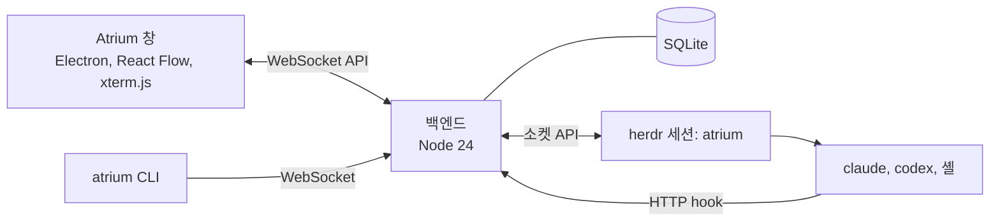

<p align="center">
  
</p>

<p align="center">
  <b>CLI 코딩 에이전트를 한 보드(무한 캔버스)에.</b><br>
  Claude Code, Codex, 셸 세션을 한눈에 보고, 어느 세션이 응답을 기다리는지 알고, 창을 옮기지 않고 요청을 보냅니다.
</p>

<p align="center">
  
  
  
  
</p>

<p align="center">
  <a href="README.md">English</a> · <b>한국어</b>
</p>


## 왜

에이전트 CLI 다섯 개를 터미널 탭 다섯 개에 띄우면, 그중 하나가 질문을 던지고 20분 동안 기다리기 전까지는 잘 돌아갑니다. Atrium은 모든 세션을 한 보드에 올립니다. 폴더마다 영역이 생기고, 세션마다 살아 있는 터미널과 상태가 보이며, 사용자의 응답이 필요한 세션은 주황색으로 빛납니다.

Atrium은 에이전트를 대신하지 않고 일하는 방식을 정하지도 않습니다. 보드는 세션을 띄우고, 세션끼리 연결해 주고, 그 연결을 보여 줍니다. 일은 에이전트가 하고, 서로에게 일을 맡길 때는 [herdr](https://herdr.dev)를 씁니다.

## 기능

- **모든 세션을 한 보드에.** Claude Code, Codex, DeepSeek(로컬 게이트웨이를 거치는 Claude Code), 일반 셸이 나란히 놓입니다. Git 저장소마다 영역이 있고, 살아 있는 git 워크트리는 그 저장소 영역 안의 노란 워크트리 영역으로 보입니다. 나중에 git 저장소가 된 폴더도 한 영역으로 남습니다.
- **런처.** 런처는 에이전트 종류(Claude Code, Codex 등)에 모델과 옵션을 더한 것, 또는 직접 쓴 명령 한 줄입니다. 설정의 런처 탭에서 드롭다운으로 만들고 별을 달면 왼쪽 도구 모음에 놓여, 한 번 눌러 세션을 띄웁니다.
- **어느 세션이 기다리는지.** 세션마다 상태(작업 중, 준비 완료, 응답 필요, 오류)를 herdr 이벤트와 Claude Code hook으로 계산합니다. **응답 필요**와 **확인할 결과** 목록, OS 알림, 트레이 배지가 볼 곳을 알려 줍니다. `AskUserQuestion` 질문에는 세션 창 위의 카드에서 바로 답합니다.
- **보드에서 요청 보내기.** 명령 입력줄에 `@이름`(또는 `@all`)을 씁니다. 세션마다 전달 대기열이 있고, 에이전트가 요청을 실제로 제출하면 확인됩니다.
- **확대되는 살아 있는 터미널.** 세션 창마다 진짜 xterm.js 터미널이고, 어느 배율에서든 끌어 고르고 복사할 수 있습니다. 멀리 보면 세션 창이 요약 카드(이름, 상태, 기다리는 질문, 마지막 요청, 마지막 답)로 바뀝니다. 카드를 누르면 그 세션으로 이동합니다.
- **창 그룹.** 세션을 tmux처럼 분할 배치로 묶습니다. 세션 수(2~6, 7 이상)마다 배치 틀이 있습니다. 창 그룹 안의 연결은 터미널 위를 지나는 선 대신 분할선 위의 작은 연결 다리나 바깥의 짧은 괄호선으로 보입니다.
- **에이전트 사이의 연결.** 한 세션에서 다른 세션으로 선을 긋고 `worker`, `reviewer` 같은 역할을 줍니다. 에이전트는 그 역할에게 herdr로 일을 맡기는 법을 알게 되고, 일이 오가는 동안 선이 빛납니다. 에이전트는 하위 세션(`atrium child`)도 띄웁니다. 수와 깊이에 제한이 없고, 보드의 `atrium` 스킬로 일을 워커와 git 워크트리에 스스로 나눠 맡깁니다. 하위 세션은 나무 모양으로 놓입니다.
- **지난 대화 이어 가기.** 연 폴더의 지난 Claude Code CLI 대화가 대화 카드로 보이고, 이어 갈 수 있습니다. 시험 폴더에 남은 대화는 *정리 대상 대화* 목록에 모았다가 한꺼번에 지웁니다.
- **데스크톱 앱에서 옮겨 오기.** Claude 데스크톱 앱에서 보관하지 않은 세션을 한 번에 가져옵니다. 세션마다 새 ID의 복제본으로 열어 앱 쪽 대화는 건드리지 않고, 그 저장소 영역에 절전 상태로 놓였다가 누르면 작업을 재개합니다. 다시 가져오면 새 세션과 앱에서 더 쓴 세션만 고릅니다.
- **한눈에 보기.** 누가 누구에게 일을 맡기는지 보여 주는 작업 관계도, 마지막으로 본 뒤의 변경 내역, 세션을 가로지르는 `Ctrl+F` 검색.
- **보드 위의 메모.** 마크다운 메모와 칸반을 세션 옆에 둡니다. 반복 작업은 같은 요청을 주기마다, 또는 세션이 쉴 때 다시 보냅니다.
- **메모리를 아낌.** 30분(설정 가능) 동안 조용한 저장소는 통째로 절전 모드에 들어가고 통째로 작업을 재개합니다. 세션 창마다 메모리 사용량이 보입니다.
- **계속 돎.** 세션은 herdr 안에서 돌기 때문에 창을 닫아도 멈추지 않습니다. 창이나 백엔드를 다시 켜면 보드가 세션을 다시 붙잡습니다.
- **스크립트로 다루기.** `atrium` CLI와 로컬 WebSocket API로 띄우기, 보내기, 잇기, 묶기, 끄기 등을 합니다.
- 영어와 한국어 화면. 한국어 번역은 [Qualop](https://github.com/Qualop)이 했습니다.

<table>
  <tr>
    <td width="50%"></td>
    <td width="50%"></td>
  </tr>
  <tr>
    <td align="center"><sub>연결이 있는 창 그룹: 리드가 작업자 둘에게 일을 맡깁니다.</sub></td>
    <td align="center"><sub>응답 필요: 세션 창 위에서 바로 답합니다.</sub></td>
  </tr>
</table>

## 필요한 것

지금은 **Windows 전용**입니다(Windows 10, 11, x64).

| | |
|---|---|
| [Node.js](https://nodejs.org/) | 24.x |
| [herdr](https://herdr.dev) | 0.9.5(프로토콜 22)로 시험했습니다. herdr 설치 폴더나 `PATH`에서 찾습니다. 다른 파일을 쓰려면 `ATRIUM_HERDR`나 설정의 herdr 경로로 줍니다. 프로토콜 22인 다른 버전은 경고와 함께 씁니다. herdr가 없어도 보드는 열리지만 세션은 시작할 수 없습니다. |
| [Claude Code](https://docs.anthropic.com/en/docs/claude-code) | `PATH`에 있는 최근 `claude` CLI. |
| Git | 저장소와 워크트리를 알아내는 데 씁니다. |
| 선택 | Codex 세션에는 Codex CLI. DeepSeek 세션에는 `127.0.0.1:10100`의 Anthropic 호환 게이트웨이(예: opencodex). |

## 시작하기

```powershell
git clone https://github.com/Gudals0320/atrium.git
cd atrium\backend
npm install
cd ..\app
npm install
npm run real
```

`npm run real`은 창을 빌드하고 보드를 엽니다. 백엔드가 돌고 있지 않으면 창이 띄우고(포트 47800), 백엔드는 `atrium`이라는 자기 herdr 세션을 띄웁니다. 다른 herdr 세션은 건드리지 않습니다. 보드의 데이터는 `%LOCALAPPDATA%\atrium`에 있습니다.

바탕화면 바로가기를 만들려면:

```powershell
powershell -ExecutionPolicy Bypass -File app\scripts\make-shortcut.ps1
```

그다음 보드에서 폴더를 열고 왼쪽 도구 모음에서 세션을 띄웁니다.

### 알아 둘 것

- Atrium은 `~/.claude/settings.json`을 고치지 않습니다. 보드가 띄우는 Claude Code 세션마다 설정 파일을 따로 만들어 `--settings`로 넘기고, 그 파일의 hook이 상태를 보드에 알립니다.
- 연 폴더의 지난 대화를 보여 주고 이어 가기 위해 `%USERPROFILE%\.claude\projects` 아래 Claude Code 대화 파일을 읽습니다.
- 모든 것이 내 컴퓨터에서 돕니다. 창은 `127.0.0.1`의 백엔드와, 백엔드는 herdr와 이야기합니다.
- 폴더 신뢰 확인("이 폴더의 파일을 신뢰합니까?")은 대신 수락하지 않고 사용자에게 남겨 둡니다. 에이전트가 Claude Code의 신뢰를 아직 받지 않은 저장소에 워크트리 워커를 띄우면, 그 워커의 세션 창에 신뢰 질문이 뜹니다.

## 원격 접속(Tailscale)

노트북 브라우저에서 [Tailscale](https://tailscale.com)로 이 판을 쓸 수 있습니다. 노트북은 PC 화면이 아니라 같은 판을 웹 페이지로 엽니다. 백엔드는 그대로 `127.0.0.1`에서만 받습니다. PC의 `tailscale serve`가 HTTPS를 끝내고 tailnet에서 온 요청을 판으로 넘깁니다.

1. PC와 노트북에 Tailscale을 설치하고 두 곳 모두 같은 계정으로 로그인합니다.
2. tailnet 관리 화면의 **DNS**에서 **MagicDNS**와 **HTTPS Certificates**를 켭니다. 이때 기기 이름과 tailnet 이름이 공개 인증서 기록(Certificate Transparency)에 남습니다.
3. PC에서 확인하고 serve를 켭니다.

   ```powershell
   node backend\bin\atrium.mjs remote status
   node backend\bin\atrium.mjs remote enable --yes
   ```

   `enable`은 `tailscale serve --bg --https=443 http://127.0.0.1:47800`을 실행합니다. `--yes`가 없으면 명령만 보입니다. https 443을 다른 서비스가 쓰고 있으면 멈추고 다른 포트를 알려 줍니다(`--https-port 8443`). `remote guide`는 이 단계를 보입니다.
4. 노트북에서 `remote status`가 보이는 주소(예: `https://my-pc.example-tailnet.ts.net/`)를 엽니다.
5. 브라우저와 짝을 맺습니다. PC 창의 **설정 › 연결된 기기**에서 **새 코드**를 누르고 노트북에 6자리 코드를 넣습니다. 노트북에서 허락을 청하고 PC에서 허락해도 됩니다. 같은 탭에 Tailscale 진단과 노트북 주소가 보입니다.
6. 패스키를 만듭니다. 짝을 맺으면 노트북이 **패스키 만들기**를 누르고 Windows Hello, Touch ID나 보안 키로 확인하라고 합니다. 이 단계를 마쳐야 기기가 생기고, 몇 분 안에 마쳐야 합니다.
7. 원하면 브라우저의 **앱 설치**로 판을 따로 된 창에서 엽니다.

세션이 끝나면 노트북에 **다시 확인**이 보입니다. 같은 패스키로 확인하면 판이 다시 열립니다. 세션은 로그인 뒤 12시간이 지나거나, 연결이 끊긴 채 30분이 지나면(노트북 잠자기 등) 끝납니다. 두 시간은 PC의 **설정 › 연결된 기기**에서 바꿉니다. 패스키는 보안 페이지에서만 됩니다. 판은 `https://…ts.net` 주소나 PC의 `http://localhost:<포트>`로 엽니다(`127.0.0.1`은 안 됩니다).

보안 주의:

- 짝 맺은 브라우저는 PC의 Windows 사용자와 같은 권한입니다. 셸을 띄워 무엇이든 실행할 수 있습니다. 내 기기만 짝 맺습니다.
- 브라우저에는 비밀번호나 토큰을 두지 않습니다. 판은 패스키의 공개 키만 둡니다. 패스키로 확인하면 세션을 `HttpOnly; SameSite=Strict` 쿠키(https면 `Secure`)로 주므로 페이지의 스크립트가 읽지 못합니다. 판은 세션 ID의 해시만 둡니다.
- 기기를 끊으면 그 기기의 세션이 모두 곧바로 끝나고 열린 연결이 닫힙니다.
- 패스키 전에 토큰으로 짝 맺은 브라우저는 더 연결할 수 없습니다. 기기 목록에 **다시 짝 맺기 필요**로 보입니다. 지우고 그 브라우저에서 다시 짝을 맺습니다.
- Tailscale로 온 요청은 PC에 로그인한 Tailscale 사용자의 것만 받습니다. 다른 로그인을 더하거나 확인을 끄는 것은 PC의 **설정 › 연결된 기기**에서 합니다.
- Tailscale로 온 요청은 hook과 하위 세션 주소를 부를 수 없고, 판 API 토큰은 브라우저에 내주지 않습니다.
- `tailscale funnel`은 쓰지 않습니다. funnel은 판을 인터넷에 공개합니다. funnel이 켜져 있으면 `remote status`가 알립니다.
- 기기를 끊으려면 **설정 › 연결된 기기**에서 **끊기**를 누르거나 `node backend\bin\atrium.mjs devices rm <ID>`를 실행합니다. 원격 접속을 끄려면 `node backend\bin\atrium.mjs remote disable --yes`를 실행합니다.

## 구조



- **herdr**가 터미널과 프로세스를 쥡니다. 창이나 백엔드가 멈춰도 세션은 계속 돕니다.
- **백엔드**(`backend/`)는 herdr 이벤트와 Claude Code hook으로 세션 상태를 계산하고, 세션마다 전달 대기열을 돌리고, 연결과 이벤트를 남기고, 보드를 SQLite(`node:sqlite`)에 저장합니다. 의존성은 `ws` 하나입니다.
- **창**(`app/`)은 React Flow로 보드를 그리고, 보이는 터미널에 xterm.js를 붙입니다.

## 개발

```powershell
cd app
npm start            # 개발용 프로필: herdr 세션 atrium-dev, 포트 47811, 데이터 backend\.dev\
cd ..\backend
npm test             # 백엔드 단위 시험
cd ..\app
npm test             # 창 단위 시험
```

개발용 보드는 실제 보드(`atrium`, 포트 47800)를 건드리지 않습니다. `app/test/e2e/`의 시험 스크립트는 따로 띄운 개발용 보드에서 Playwright로 창을 움직입니다. [docs/testing.md](docs/testing.md)를 봅니다.

설계 문서는 한국어입니다. 문서는 코드와 맞춘 내부 용어(판, 덩어리, 워크스페이스 등)를 씁니다.

- [docs/BRIEF.md](docs/BRIEF.md): 왜, 무엇, 정한 것, 사용성 원칙, 위험
- [docs/ARCH.md](docs/ARCH.md): 프로세스, 상태 모델, 기능, 모듈, API, 화면
- [docs/PLAN.md](docs/PLAN.md): 지금 할 일과 열린 결정
- [docs/decisions.md](docs/decisions.md): 결정이 바뀐 경위

## 상태

Atrium은 초기 프로젝트입니다. Claude Code와 함께 단계별로 만들었고, 화면은 매일 쓰면서 다듬고 있습니다. 거친 곳이 있을 수 있으니 문제를 만나면 이슈로 알려 주세요.

## 고마운 것

- [herdr](https://herdr.dev), [React Flow](https://reactflow.dev), [xterm.js](https://xtermjs.org), [Electron](https://www.electronjs.org).
- 한국어 화면 번역: [Qualop](https://github.com/Qualop). [Qualop/atrium-macos](https://github.com/Qualop/atrium-macos)의 번역을 바탕으로 다듬었습니다.
- 글꼴: Geist, JetBrains Mono, Pretendard, 나눔고딕코딩(SIL Open Font License).
- Claude, Codex, DeepSeek, Grok, Pi의 이름과 로고는 각 소유자의 상표입니다. Atrium은 세션 종류를 표시하는 데만 쓰며, 이들과 제휴하거나 보증받지 않았습니다.

자세한 내용은 [app/THIRD_PARTY_NOTICES.txt](app/THIRD_PARTY_NOTICES.txt)에 있습니다.

## 라이선스

[MIT](LICENSE) © 2026 Gudals0320
