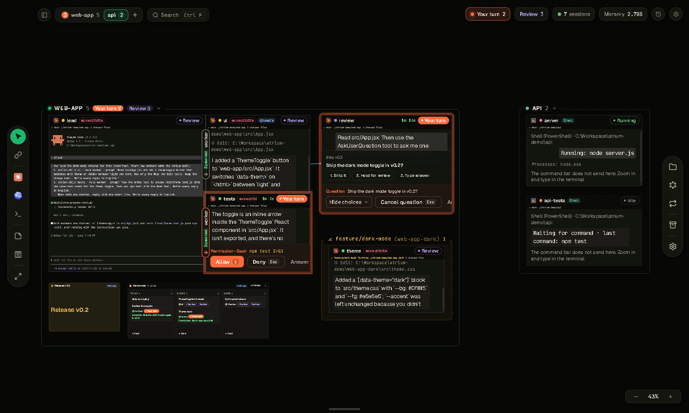
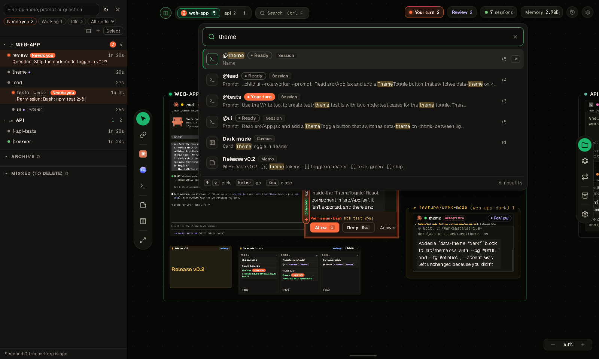
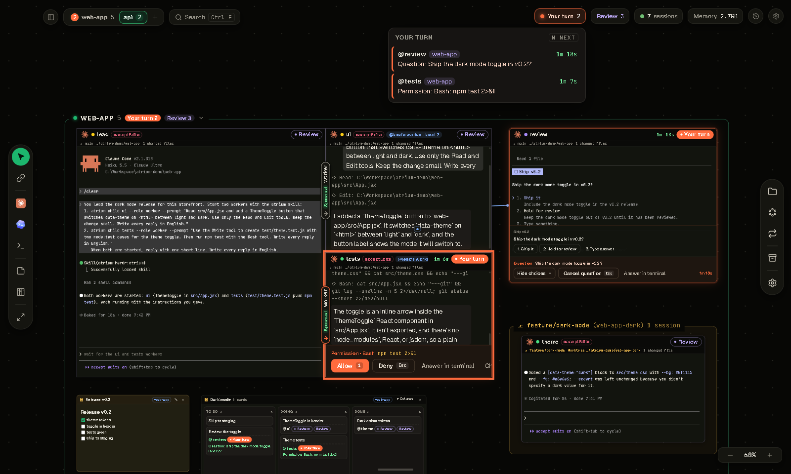
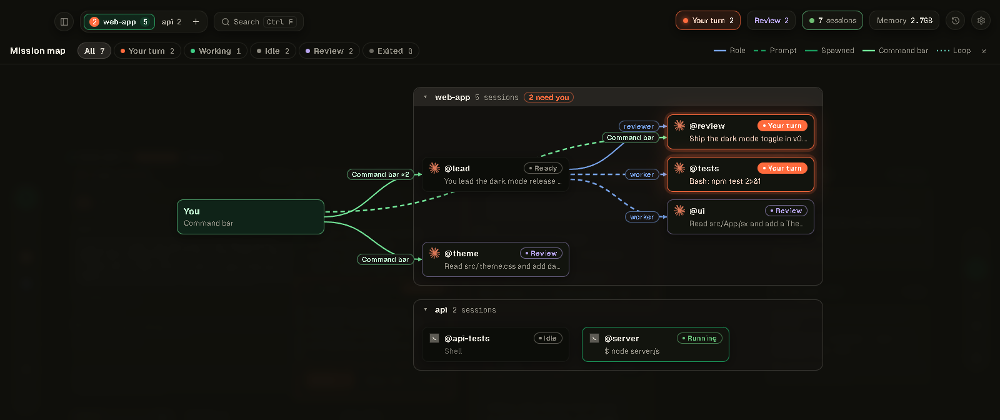
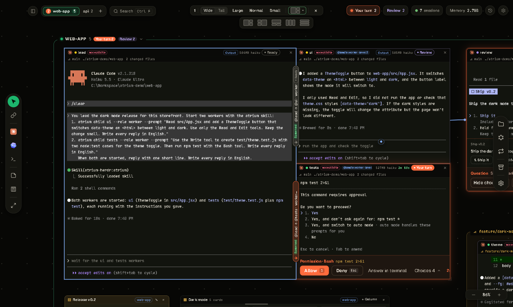
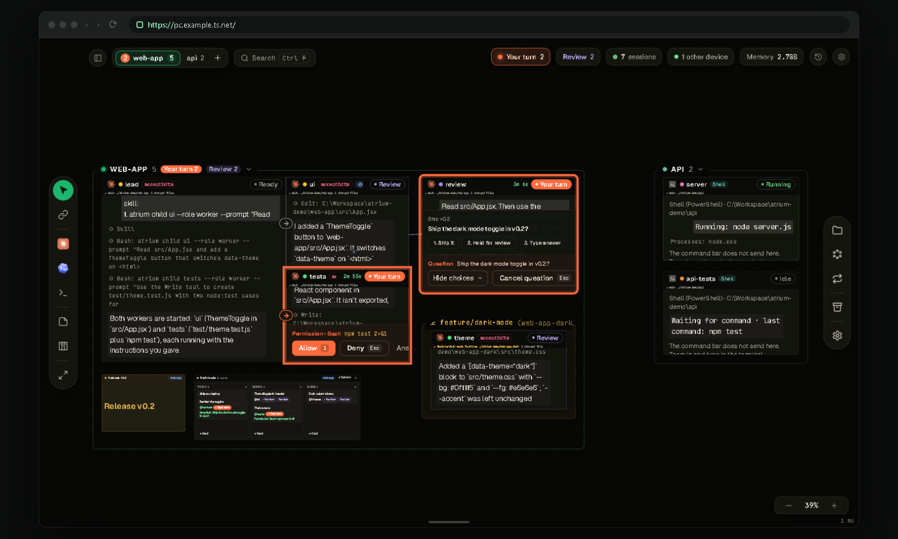
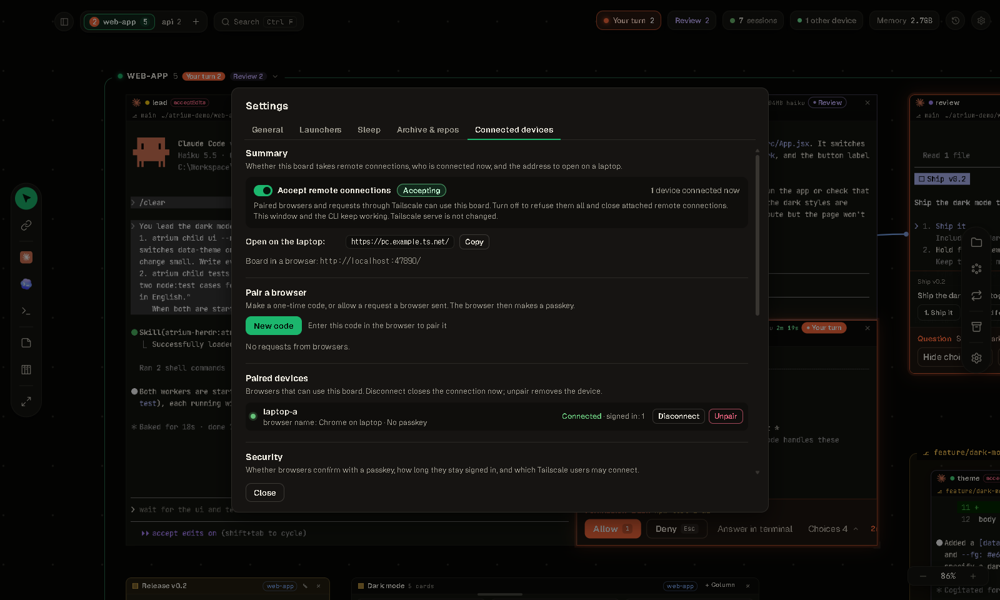

<p align="center">
  
</p>

<p align="center">
  <b>CLI 코딩 에이전트를 한 보드(무한 캔버스)에.</b><br>
  Claude Code, Codex, 셸 세션을 한눈에 보고, 어느 세션이 응답을 기다리는지 알고, 창을 옮기지 않고 요청을 보냅니다.
</p>

<p align="center">
  
  
  
  
</p>

<p align="center">
  <a href="README.md">English</a> · <b>한국어</b>
</p>



## 무엇인가

Atrium은 에이전트 CLI 세션을 모두 한 보드에 올리는 Windows 데스크톱 앱입니다. 저장소마다 영역이 생기고, 세션마다 살아 있는 터미널과 상태가 보이며, 사용자의 응답이 필요한 세션은 주황색으로 빛납니다.

Atrium은 에이전트를 대신하지 않고 일하는 방식을 정하지도 않습니다. 보드는 세션을 띄우고, 세션끼리 연결해 주고, 그 연결을 보여 줍니다. 일은 에이전트가 하고, 서로에게 일을 맡길 때는 [herdr](https://herdr.dev)를 씁니다. 터미널도 herdr가 쥐고 있어서 창을 닫아도 세션은 계속 돕니다.

## 기능

### 보드

- **모든 세션을 한 캔버스에.** Claude Code, Codex, herdr가 아는 다른 에이전트, 일반 셸이 나란히 놓입니다. 저장소마다 영역이 있고, 살아 있는 git 워크트리는 그 저장소 영역 안의 노란 상자로 보입니다.
- **배율에 따라 바뀌는 얼굴.** 가까이 보면 세션 창이 터미널이고, 멀어지면 대화 보기, 더 멀어지면 요약 카드(이름, 상태, 기다리는 질문, 마지막 요청, 마지막 답)가 됩니다. 세션 창을 누르면 그리로 이동합니다.
- **런처.** 런처는 하네스에 모델과 옵션을 더한 것, 또는 직접 쓴 명령 한 줄입니다. 별을 달면 왼쪽 도구 모음에 놓여 한 번 눌러 세션을 띄웁니다.
- **사이드바와 검색.** 사이드바(`Ctrl+Shift+E`)는 세션이 200개 넘는 보드를 위해 만들었습니다. 저장소를 묶는 가상 그룹, 상태·종류 거르기, 키보드 이동이 있습니다. `Ctrl+F`는 이름, 요청, 질문, 답과 메모, 칸반 카드에서 찾습니다.
- **지난 작업 이어 가기.** 연 폴더의 지난 Claude Code CLI 대화가 카드로 보이고 이어 갈 수 있습니다. Claude 데스크톱 앱에서 보관하지 않은 세션은 복제본으로 가져와 앱 쪽 대화를 건드리지 않습니다.
- **메모리를 아낌.** 30분(설정 가능) 동안 조용한 저장소는 통째로 절전 모드에 들어가고, 그 세션 창 하나를 누르면 다시 깨어납니다. 세션 창마다 메모리 사용량이 보입니다.



### 응답 필요

- **누가 기다리는지.** 세션마다 상태(작업 중, 준비 완료, 응답 필요, 오류)를 herdr 이벤트와 Claude Code hook으로 계산합니다. 아직 보지 않은 완료 답은 **확인할 결과**로 셉니다.
- **세션 창에서 바로 답하기.** 권한 요청과 `AskUserQuestion` 질문은 세션 창 아래쪽 카드로 열립니다. 허용, 거부, 선택지 고르기, 터미널에서 답하기 중에서 고릅니다.
- **모든 저장소를 한 목록에.** 위쪽 **응답 필요** 알약이 기다리는 세션을 오래 기다린 순서로 보이고, `N`으로 다음 세션에 갑니다. 창이 뒤에 있으면 OS 알림과 트레이 아이콘이 알려 줍니다.
- **보지 않은 사이의 변경.** 자리를 비웠다 돌아오면 **변경 내역**이 세션마다 한 일을 모아 보입니다.



### 에이전트끼리

- **역할 연결.** 한 세션에서 다른 세션으로 선을 긋고 `worker`, `reviewer` 같은 역할을 줍니다. 에이전트는 그 역할에게 herdr로 일을 맡기는 법을 알게 되고, 일이 오가는 동안 선이 빛납니다. 에이전트가 herdr로 스스로 맡긴 일도 선으로 그립니다.
- **필요할 때 띄우는 작업자.** 에이전트는 `atrium child`로 자기 작업자를 띄웁니다. 수와 깊이에 제한이 없습니다. 보드의 `atrium` 스킬이 언제 일을 작업자와 git 워크트리로 나눌지 알려 줍니다. 작업자의 머리줄에 부모와 역할이 보입니다.
- **말로 고르는 모델.** `atrium child --model "deepseek flash"`처럼 말한 모델 이름을 보드가 아는 모델(`atrium models`)에서 찾고, 모델 오류는 부모에게 돌려줍니다.
- **작업 관계도와 요청 기록.** `M`은 누가 누구에게 일을 맡기는지 저장소별로 보이는 관계도를 엽니다. 요청 기록은 명령 입력줄로 보낸 요청과 전달 상태, 완료 결과를 남깁니다.
- **보드에서 요청 보내기.** 명령 입력줄에 `@이름`이나 `@all`을 씁니다. 세션마다 전달 대기열이 있고, 에이전트가 요청을 실제로 제출해야 확인됩니다. 반복 작업은 같은 요청을 주기마다, 또는 세션이 쉴 때 다시 보냅니다.



### 살아 있는 터미널

- **진짜 터미널.** 가까이 보이는 세션 창은 herdr 패널에 붙은 xterm.js 터미널이라 바로 입력할 수 있습니다.
- **웹처럼 고르기.** 어느 배율에서든 끌어 고릅니다. 선택은 스크롤을 따라가고, 가장자리에서 저절로 스크롤되며, 화면 밖까지 복사합니다.
- **붙여넣기.** 에이전트에는 괄호 붙여넣기로, 셸에는 여러 줄 그대로 넣습니다.
- **배율.** 화면과 터미널 글자 배율을 70%에서 150%까지 바꿉니다.
- **응답 보기.** 긴 답은 옆 창에 마크다운으로 열려, 거기서 답장하거나 `.md`로 저장합니다.

### 창 그룹과 배치

- **창 그룹.** 세션 창을 `Ctrl`+끌기로 다른 세션 창 가장자리에 놓으면 tmux처럼 나눠 붙습니다. 배치 틀은 세션 수에 맞춰 나옵니다(2~6개, 7개 이상은 고르게 나누기). 창 그룹 안의 연결은 터미널 위를 지나는 선 대신 분할선 위의 작은 다리로 보입니다.
- **크기와 자동 정렬.** 세션 창과 창 그룹 전체에 크기 단계(크게, 보통, 작게, 가로, 세로)를 줍니다. **자동 정렬**은 연결을 따라 보드를 다시 놓고 한 번 되돌릴 수 있습니다.
- **보드 위의 메모.** 마크다운 메모와 칸반을 세션 옆에 둡니다. 세션에 이은 칸반 카드는 그 세션의 상태를 보이고, 누르면 그 세션으로 갑니다.



### 원격 접속

- **브라우저로 같은 보드.** 노트북에서 [Tailscale](https://tailscale.com)로 같은 보드를 엽니다. 백엔드는 그대로 `127.0.0.1`에서만 받고, PC의 `tailscale serve`가 tailnet의 요청을 넘깁니다.
- **코드로 짝 맺기.** PC에서 **새 코드**를 누르거나 노트북의 요청을 허락합니다. 짝 맺은 브라우저는 짝을 맺은 Tailscale 기기에 묶입니다.
- **패스키는 선택.** 기본은 꺼짐입니다. 켜면 휴대폰이나 Windows Hello 패스키로 로그인을 확인합니다.
- **PC가 쥐고 있음.** 연결 기록, 붙음 알림, 기기마다 **끊기**와 **짝 풀기**, **원격 받기** 스위치가 있습니다.
- 클라이언트마다 화면 위치를 따로 둡니다. 브라우저에서는 PC 폴더를 고르고 파일을 터미널에 끌어 놓을 수도 있습니다.

<table>
  <tr>
    <td width="50%"></td>
    <td width="50%"></td>
  </tr>
  <tr>
    <td align="center"><sub>노트북 브라우저에서 연 같은 보드.</sub></td>
    <td align="center"><sub>PC의 연결된 기기 탭.</sub></td>
  </tr>
</table>

영어와 한국어 화면. 한국어 번역은 [Qualop](https://github.com/Qualop)이 했습니다.

## 필요한 것

지금은 **Windows 전용**입니다(Windows 10, 11, x64).

| | |
|---|---|
| [Node.js](https://nodejs.org/) | 24.x |
| [herdr](https://herdr.dev) | 0.9.5(프로토콜 22)로 시험했습니다. herdr 설치 폴더나 `PATH`에서 찾고, 다른 파일을 쓰려면 `ATRIUM_HERDR`나 설정의 herdr 경로로 줍니다. 프로토콜 22인 다른 버전은 경고와 함께 씁니다. herdr가 없어도 보드는 열리지만 세션은 시작할 수 없습니다. |
| [Claude Code](https://docs.anthropic.com/en/docs/claude-code) | `PATH`에 있는 최근 `claude` CLI. |
| Git | 저장소와 워크트리를 알아내는 데 씁니다. |
| 선택 | Codex 세션에는 Codex CLI. DeepSeek 세션에는 `127.0.0.1:10100`의 Anthropic 호환 게이트웨이(예: opencodex). 원격 접속에는 Tailscale. |

## 시작하기

```powershell
git clone https://github.com/Gudals0320/atrium.git
cd atrium\backend
npm install
cd ..\app
npm install
npm run real
```

`npm run real`은 창을 빌드하고 보드를 엽니다. 백엔드가 돌고 있지 않으면 창이 띄우고(포트 47800), 백엔드는 `atrium`이라는 자기 herdr 세션을 띄웁니다. 다른 herdr 세션은 건드리지 않습니다. 보드의 데이터는 `%LOCALAPPDATA%\atrium`에 있습니다.

바탕화면 바로가기를 만들려면:

```powershell
powershell -ExecutionPolicy Bypass -File app\scripts\make-shortcut.ps1
```

그다음 보드에서 폴더를 열고 왼쪽 도구 모음에서 세션을 띄웁니다.

보드의 키: `N` 다음 응답 필요 세션, `M` 작업 관계도, `Ctrl+F`나 `↑` 검색, `↓` 명령 입력줄, `Ctrl+Shift+E` 사이드바, `Delete` 고른 세션 닫기.

### 알아 둘 것

- Atrium은 `~/.claude/settings.json`을 고치지 않습니다. 보드가 띄우는 Claude Code 세션마다 설정 파일을 따로 만들어 `--settings`로 넘기고, 그 파일의 hook이 상태를 보드에 알립니다.
- 연 폴더의 지난 대화를 보여 주고 이어 가기 위해 `%USERPROFILE%\.claude\projects` 아래 Claude Code 대화 파일을 읽습니다.
- 모든 것이 내 컴퓨터에서 돕니다. 창은 `127.0.0.1`의 백엔드와, 백엔드는 herdr와 이야기합니다.
- 폴더 신뢰 확인("이 폴더의 파일을 신뢰합니까?")은 대신 수락하지 않고 사용자에게 남겨 둡니다. 에이전트가 Claude Code의 신뢰를 아직 받지 않은 저장소에 워크트리 작업자를 띄우면, 그 작업자의 세션 창에 신뢰 질문이 뜹니다.

## 원격 접속(Tailscale)

1. PC와 노트북에 Tailscale을 설치하고 같은 계정으로 로그인합니다. tailnet 관리 화면에서 **MagicDNS**와 **HTTPS Certificates**를 켭니다(이때 기기 이름과 tailnet 이름이 공개 인증서 기록(Certificate Transparency)에 남습니다).
2. PC에서 확인하고 serve를 켭니다.

   ```powershell
   node backend\bin\atrium.mjs remote status
   node backend\bin\atrium.mjs remote enable --yes
   ```

3. 노트북에서 `remote status`가 보이는 주소(예: `https://my-pc.example-tailnet.ts.net/`)를 엽니다.
4. PC 창의 **설정 › 연결된 기기**에서 **새 코드**를 누르고 노트북에 6자리 코드를 넣습니다. 보드가 곧바로 열립니다.

<details>
<summary><b>자세히: serve, 패스키, 보안 주의</b></summary>

**serve.** `remote enable`은 `tailscale serve --bg --https=443 http://127.0.0.1:47800`을 실행합니다. `--yes`가 없으면 명령만 보입니다. https 443을 다른 서비스가 쓰고 있으면 멈추고 다른 포트를 알려 줍니다(`--https-port 8443`). `remote guide`는 이 단계를 보입니다. 코드 대신 노트북에서 허락을 청하고 PC에서 허락해도 됩니다. 브라우저의 **앱 설치**로 보드를 따로 된 창에서 엽니다.

**설정 › 연결된 기기 › 보안 설정**의 **패스키로 확인**(기본 꺼짐)은 짝 맺은 브라우저가 들어오는 방법을 정합니다.

- **끔**: 짝 맺은 브라우저는 짝을 맺은 Tailscale 기기에서 보드가 바로 열리고, 짝을 풀 때까지 이어집니다. 개인 노트북이면 Tailscale 기기 묶기, 세션 쿠키, 출처 확인, 붙음 알림만으로도 다른 기기는 들어오지 못합니다.
- **켬**: 짝을 맺으면 노트북이 **패스키 만들기**를 누르고 휴대폰(iPhone·Android, QR 찍기)이나 이 기기(Windows Hello, Touch ID, 보안 키)로 확인하라고 합니다. 세션이 끝나면 노트북에 **다시 확인**이 보입니다. 세션은 로그인 뒤 12시간이 지나거나 연결이 끊긴 채 30분이 지나면 끝나고, 두 시간은 같은 탭에서 바꿉니다. 패스키는 세션이 끝난 뒤 노트북을 손에 넣은 사람도 막습니다. 이것은 Windows 잠금 화면과 많이 겹칩니다.
- 켜면, 패스키 없이 짝 맺은 브라우저는 다음 접속 때 **이 브라우저의 패스키 등록** 화면을 봅니다. 그때까지 기기 목록에 **패스키 등록 필요**로 보입니다. 끄면 살아 있는 세션은 짝을 풀 때까지 이어지고, 패스키 기록은 그대로 둡니다.
- 패스키는 보안 페이지에서만 됩니다. 보드는 `https://…ts.net` 주소나 PC의 `http://localhost:<포트>`로 엽니다(`127.0.0.1`은 안 됩니다).

**보안 주의.**

- 짝 맺은 브라우저는 PC의 Windows 사용자와 같은 권한입니다. 셸을 띄워 무엇이든 실행할 수 있습니다. 내 기기만 짝 맺습니다.
- 브라우저에는 비밀번호나 토큰을 두지 않습니다. 세션은 `HttpOnly; SameSite=Strict` 쿠키(https면 `Secure`)라 페이지의 스크립트가 읽지 못합니다. 보드는 세션 ID의 해시와 패스키의 공개 키만 둡니다.
- 짝 맺은 브라우저는 짝을 맺은 Tailscale 기기에서만 씁니다. 보드는 요청한 기기를 `tailscale whois`로 확인합니다. PC 안(`localhost`)에서 짝 맺은 브라우저는 PC 안에서만 씁니다. 기기에 묶이기 전에(또는 옛 토큰으로) 짝 맺은 브라우저는 **다시 짝 맺기 필요**로 보이니 지우고 다시 짝을 맺습니다.
- Tailscale로 온 요청은 PC에 로그인한 Tailscale 사용자의 것만 받습니다(다른 로그인은 **연결된 기기**에서 더합니다). 이 요청은 hook과 하위 세션 주소를 부를 수 없고, 보드 API 토큰은 브라우저에 내주지 않습니다.
- `tailscale funnel`은 쓰지 않습니다. funnel은 보드를 인터넷에 공개합니다. funnel이 켜져 있으면 `remote status`가 알립니다.
- 기기가 붙거나 짝을 맺으면 PC 창에 알림이 뜹니다. 위쪽 **다른 기기 n** 알약에 기기마다 **끊기**와 **짝 풀기**가 있고, 브라우저는 자기 짝만 풀 수 있습니다. **원격 받기**를 끄면(설정, 트레이 메뉴, `remote block`) 짝 맺은 기기를 모두 거부하고 연결을 닫습니다. `remote allow`로 다시 받습니다. 패스키로 확인이 켜져 있으면 끊기와 막기가 세션도 끝냅니다.
- 짝 맺기, 로그인, 연결과 끊김, 패스키로 확인 켬·끔, 거부와 그 까닭은 연결 기록(`remote log`)에 남습니다.
- CLI로 짝을 풀려면 `node backend\bin\atrium.mjs devices rm <ID>`, serve를 끄려면 `node backend\bin\atrium.mjs remote disable --yes`를 실행합니다.

</details>

## CLI

`atrium` CLI는 도는 백엔드와 이야기합니다. `node backend\bin\atrium.mjs <명령>`으로 부르고, `--help`가 전부를 보입니다.

| 명령 | 하는 일 |
|---|---|
| `spawn <폴더> [--launcher l] [--name n] [--model m] [--kind shell]` | 세션 띄우기 |
| `ls`, `inbox`, `get <이름>` | 세션과 상태, 응답이 필요한 것, 세션 하나 자세히 |
| `send @이름 [@이름…] <글> [--wait]` | 요청 보내기(`@all`은 모든 에이전트) |
| `answer <이름> <번호\|reject>` | 권한 요청이나 질문에 답하기 |
| `link <A> <B> --role worker` | 두 세션을 역할로 잇기 |
| `dock <A> <B>`, `dock layout <틀> <A> <B> …` | 창 그룹으로 묶기, 배치 틀로 짜기 |
| `arrange --all --apply` | 보드 전체 자동 정렬 |
| `kill <이름> --yes` | 세션 닫기 |
| `remote status`, `remote log`, `devices` | 원격 접속, 연결 기록, 짝 맺은 기기 |

보드가 띄운 세션은 자기 작업자를 위한 `atrium child`, `atrium children`, `atrium models`도 씁니다.

## 구조


- **herdr**가 터미널과 프로세스를 쥡니다. 창이나 백엔드가 멈춰도 세션은 계속 돌고, 다시 켜면 보드가 세션을 다시 붙잡습니다.
- **백엔드**(`backend/`)는 herdr 이벤트와 Claude Code hook으로 세션 상태를 계산하고, 세션마다 전달 대기열을 돌리고, 연결과 이벤트를 남기고, 웹 화면을 내주고, 보드를 SQLite(`node:sqlite`)에 저장합니다. 의존성은 `ws` 하나입니다.
- **창**(`app/`)은 React Flow로 보드를 그리고, 화면에 보이는 터미널에 xterm.js를 붙입니다. PC 창과 짝 맺은 브라우저는 모두 같은 백엔드의 클라이언트입니다.

## 개발

```powershell
cd app
npm start            # 개발용 프로필: herdr 세션 atrium-dev, 포트 47811, 데이터 backend\.dev\
cd ..\backend
npm test             # 백엔드 단위 시험
cd ..\app
npm test             # 창 단위 시험
```

개발용 보드는 실제 보드(`atrium`, 포트 47800)를 건드리지 않습니다. `app/test/e2e/`의 시험 스크립트는 따로 띄운 개발용 보드에서 Playwright로 창을 움직입니다. [docs/testing.md](docs/testing.md)를 봅니다. 이 README의 그림은 `app/test/e2e/readme-shots.mjs`(`seed`, `shoot`, `publish`, `clean`)가 꾸민 데모 보드에서 찍었습니다.

설계 문서는 한국어입니다. 문서는 코드와 맞춘 내부 용어(판, 덩어리, 워크스페이스 등)를 씁니다.

- [docs/BRIEF.md](docs/BRIEF.md): 왜, 무엇, 정한 것, 사용성 원칙, 위험
- [docs/ARCH.md](docs/ARCH.md): 프로세스, 상태 모델, 기능, 모듈, API, 화면
- [docs/PLAN.md](docs/PLAN.md): 지금 할 일과 열린 결정
- [docs/decisions.md](docs/decisions.md): 결정이 바뀐 경위
- [CHANGELOG.md](CHANGELOG.md): 단계마다 만든 것

## 상태

Atrium은 초기 프로젝트입니다. Claude Code와 함께 단계별로 만들었고, 화면은 매일 쓰면서 다듬고 있습니다. 거친 곳이 있을 수 있으니 문제를 만나면 이슈로 알려 주세요.

## 고마운 것

- [herdr](https://herdr.dev), [React Flow](https://reactflow.dev), [xterm.js](https://xtermjs.org), [Electron](https://www.electronjs.org).
- 한국어 화면 번역: [Qualop](https://github.com/Qualop). [Qualop/atrium-macos](https://github.com/Qualop/atrium-macos)의 번역을 바탕으로 다듬었습니다.
- 글꼴: Geist, JetBrains Mono, Pretendard, 나눔고딕코딩(SIL Open Font License).
- Claude, Codex, DeepSeek, Grok, Pi의 이름과 로고는 각 소유자의 상표입니다. Atrium은 세션 종류를 표시하는 데만 쓰며, 이들과 제휴하거나 보증받지 않았습니다.

자세한 내용은 [app/THIRD_PARTY_NOTICES.txt](app/THIRD_PARTY_NOTICES.txt)에 있습니다.

## 라이선스

[MIT](LICENSE) © 2026 Gudals0320. 제삼자 로고와 글꼴은 MIT 라이선스가 아닙니다. [app/THIRD_PARTY_NOTICES.txt](app/THIRD_PARTY_NOTICES.txt)를 봅니다.
