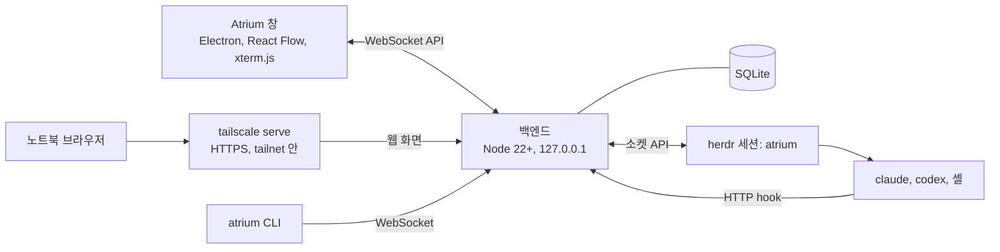

<p align="center">
  
</p>

<p align="center">
  <b>CLI 코딩 에이전트를 하나의 보드에서 관리하세요.</b><br>
  Claude Code, Codex, 셸 세션의 상태를 한눈에 확인하고, 창을 전환하지 않고도 응답이 필요한 세션에 요청을 보낼 수 있습니다.
</p>

<p align="center">
  
  
  
  
</p>

<p align="center">
  <a href="README.md">English</a> · <b>한국어</b>
</p>


## Atrium 소개

Atrium은 여러 CLI 에이전트 세션을 하나의 무한 캔버스에서 관리하는 Windows 데스크톱 앱입니다. 저장소마다 별도의 영역에 세션의 터미널과 상태를 표시합니다. 사용자 응답이 필요한 세션은 주황색으로 강조됩니다.

Atrium은 세션을 실행하고, 세션 사이의 연결을 만들고 표시합니다. 에이전트가 작업을 수행하며, 다른 에이전트에게 작업을 맡길 때는 [herdr](https://herdr.dev)를 사용합니다. 터미널과 프로세스도 herdr에서 관리하므로 앱 창을 닫아도 세션은 계속 실행됩니다. 작업 방식은 사용자가 정할 수 있습니다.

## 기능

### 보드

- **모든 세션을 하나의 캔버스에서 관리.** Claude Code, Codex, herdr에서 인식하는 다른 에이전트, 일반 셸을 나란히 배치합니다. 저장소마다 영역이 있으며, 사용 중인 Git 워크트리는 해당 저장소 영역 안에 노란색 상자로 표시됩니다.
- **배율에 맞춘 세션 표시.** 확대하면 터미널을, 축소하면 대화 내용을 표시합니다. 더 축소하면 이름, 상태, 응답 대기 중인 질문, 마지막 요청과 응답을 요약 카드로 표시합니다. 세션 창을 클릭하면 해당 세션으로 이동합니다.
- **런처.** 에이전트 종류에 모델과 실행 옵션을 지정하거나, 명령 한 줄을 런처로 저장할 수 있습니다. 즐겨찾기에 추가하면 왼쪽 도구 모음에서 한 번의 클릭으로 세션을 시작할 수 있습니다.
- **사이드바와 검색.** 사이드바(`Ctrl+Shift+E`)에서 200개가 넘는 세션도 탐색할 수 있습니다. 저장소를 묶는 가상 그룹, 상태·종류별 필터, 키보드 탐색을 지원합니다. `Ctrl+F`로 이름, 요청, 질문, 응답, 메모, 칸반 카드를 검색할 수 있습니다.
- **이전 작업 이어가기.** 프로젝트 폴더의 이전 Claude Code CLI 대화를 카드로 표시하며, 해당 대화를 이어갈 수 있습니다. Claude 데스크톱 앱의 보관되지 않은 세션은 복제본으로 가져오므로 원본 대화는 변경하지 않습니다.
- **자동 절전 모드.** 저장소에 30분 동안 활동이 없으면 해당 저장소의 세션을 절전 모드로 전환합니다. 대기 시간은 설정에서 바꿀 수 있습니다. 세션 창을 클릭하면 작업을 재개하며, 각 창에서 메모리 사용량을 확인할 수 있습니다.


### 응답 필요

- **응답이 필요한 세션 확인.** herdr 이벤트와 Claude Code hook으로 세션 상태(작업 중, 준비 완료, 응답 필요, 오류)를 판단합니다. 완료되었지만 아직 확인하지 않은 응답은 **확인할 결과**로 표시합니다.
- **세션 창에서 바로 응답.** 권한 요청과 `AskUserQuestion` 질문을 세션 창 하단의 카드로 표시합니다. 허용, 거부, 선택지 선택 또는 터미널 직접 입력으로 응답할 수 있습니다.
- **모든 저장소의 응답 요청을 한곳에서 확인.** 상단의 **응답 필요** 버튼을 누르면 대기 시간이 긴 세션부터 표시합니다. `N` 키로 다음 세션으로 이동할 수 있습니다. 앱이 백그라운드에 있을 때는 Windows 알림과 트레이 아이콘으로 알려 줍니다.
- **자리 비운 동안의 변경 내역.** 앱으로 돌아오면 **변경 내역**에서 세션별 진행 상황을 모아 확인할 수 있습니다.


### 에이전트 협업

- **역할로 세션 연결.** 한 세션에서 다른 세션으로 연결선을 그리고 `worker`, `reviewer` 등의 역할을 지정합니다. 에이전트는 해당 역할에 herdr로 작업을 맡길 수 있으며, 작업을 주고받는 동안 연결선이 강조됩니다. 에이전트가 herdr로 직접 맡긴 작업도 연결선으로 표시합니다.
- **하위 세션 생성.** 에이전트가 `atrium child`로 하위 세션을 생성할 수 있습니다. 세션 수와 생성 깊이에는 제한이 없습니다. 보드의 `atrium` 스킬에서 하위 세션과 Git 워크트리로 작업을 나누는 방법을 안내합니다. 하위 세션은 상위 세션 오른쪽에 생성 순서대로 한 줄로 놓이고, 제목 표시줄에 상위 세션, 역할, 순서 번호를 표시합니다.
- **모델 이름으로 실행.** `atrium child --model "deepseek flash"`처럼 입력하면 사용 가능한 모델 목록(`atrium models`)에서 일치하는 모델을 찾습니다. 모델 오류는 상위 세션에 전달합니다.
- **작업 관계도와 요청 기록.** `M` 키로 세션 간 작업 위임 관계를 저장소별로 확인할 수 있습니다. 명령 입력줄로 보낸 요청의 전달 상태와 완료 결과는 요청 기록에 남습니다.
- **보드에서 요청 전송.** 명령 입력줄에 `@이름` 또는 `@all`과 요청을 입력합니다. 세션별 전송 대기열이 있으며, 에이전트가 요청을 실제로 제출했는지 확인합니다. 반복 작업은 일정한 주기 또는 세션이 대기 상태가 될 때 같은 요청을 다시 보냅니다.


### 터미널

- **터미널 직접 조작.** 확대된 세션 창은 herdr 터미널 창에 연결된 xterm.js 터미널입니다. 명령을 직접 입력할 수 있습니다.
- **텍스트 선택과 복사.** 어느 배율에서든 드래그해서 텍스트를 선택할 수 있습니다. 선택 영역은 스크롤을 따라가며, 창 가장자리에서는 자동으로 스크롤됩니다. 화면 밖의 내용까지 선택해 복사할 수 있습니다.
- **붙여넣기.** 에이전트에는 브래킷 붙여넣기(bracketed paste) 방식으로, 셸에는 여러 줄을 그대로 입력합니다.
- **배율 조절.** 화면과 터미널 글자의 배율을 각각 70~150%로 조절할 수 있습니다.
- **응답 보기.** 긴 응답을 별도 패널에서 마크다운 문서로 볼 수 있습니다. 패널에서 답장을 보내거나 `.md` 파일로 저장할 수 있습니다.

### 창 그룹과 배치

- **창 그룹.** `Ctrl`을 누른 채 세션 창을 다른 창의 가장자리로 드래그하면 tmux처럼 분할 배치됩니다. 세션 수에 맞는 분할 레이아웃을 제공합니다(2~6개, 7개 이상은 균등 배치). 창 그룹 안의 연결은 터미널을 가로지르는 선 대신 분할선 위의 연결 표시로 나타납니다.
- **크기와 자동 정렬.** 세션 창과 창 그룹의 칸마다 크기(크게, 보통, 작게)와 방향(가로형, 세로형)을 지정할 수 있습니다. **자동 정렬**은 연결 관계에 따라 보드를 재배치하며, 한 번 되돌릴 수 있습니다.
- **메모와 칸반.** 세션 옆에 마크다운 메모와 칸반을 배치할 수 있습니다. 세션에 연결된 칸반 카드에는 해당 세션의 상태를 표시하며, 카드를 클릭하면 세션으로 이동합니다.


### 원격 접속

- **브라우저에서 같은 보드 사용.** 노트북에서 [Tailscale](https://tailscale.com)로 PC의 보드에 접속할 수 있습니다. 백엔드는 `127.0.0.1`에서만 요청을 수신하며, PC의 `tailscale serve`가 tailnet의 요청을 전달합니다.
- **기기 등록.** PC에서 **새 코드**를 발급해 노트북에 입력하거나, 노트북의 연결 요청을 PC에서 승인합니다. 등록된 브라우저는 등록에 사용한 Tailscale 기기에서만 접속할 수 있습니다.
- **선택 가능한 패스키 인증.** 기본값은 꺼짐입니다. 켜면 휴대폰 또는 Windows Hello 등의 패스키로 로그인할 때 본인을 확인합니다.
- **PC에서 원격 접속 관리.** 연결 기록, 접속 알림, 기기별 **연결 끊기**·**기기 등록 해제**, **원격 접속 허용** 스위치를 제공합니다.
- 클라이언트별로 화면 위치를 따로 저장합니다. 브라우저에서 PC의 폴더를 선택하고 터미널에 파일을 드래그해 업로드할 수도 있습니다.

<table>
  <tr>
    <td width="50%"></td>
    <td width="50%"></td>
  </tr>
  <tr>
    <td align="center"><sub>노트북 브라우저에서 연 같은 보드.</sub></td>
    <td align="center"><sub>PC의 연결된 기기 탭.</sub></td>
  </tr>
</table>

영어와 한국어 화면. 한국어 번역은 [Qualop](https://github.com/Qualop)이 했습니다.

## 설치 요구 사항

지금은 **Windows 전용**입니다(Windows 10, 11, x64).

| | |
|---|---|
| [Node.js](https://nodejs.org/) | 22.13 이상(22와 24에서 시험) |
| [herdr](https://herdr.dev) | 0.9.5(프로토콜 22)로 테스트했습니다. herdr 설치 폴더와 `PATH`에서 실행 파일을 찾습니다. 다른 파일을 사용하려면 `ATRIUM_HERDR` 또는 설정의 herdr 경로로 지정하세요. 프로토콜 22를 사용하는 다른 버전에는 경고를 표시합니다. herdr가 없어도 보드는 열리지만 세션은 시작할 수 없습니다. |
| [Claude Code](https://docs.anthropic.com/en/docs/claude-code) | `PATH`에 있는 최근 `claude` CLI. |
| Git | 저장소와 워크트리를 인식하는 데 사용합니다. |
| 선택 | Codex 세션에는 Codex CLI. DeepSeek 세션에는 `127.0.0.1:10100`의 Anthropic 호환 게이트웨이(예: opencodex). 원격 접속에는 Tailscale. |

## 시작하기

```powershell
git clone https://github.com/Gudals0320/atrium.git
cd atrium\backend
npm install
cd ..\app
npm install
npm run real
```

`npm run real`은 앱을 빌드한 뒤 보드를 엽니다. 백엔드가 실행 중이 아니면 앱에서 시작합니다(포트 47800). 백엔드는 전용 herdr 세션인 `atrium`을 시작합니다. 다른 herdr 세션은 변경하지 않습니다. 보드 데이터는 `%LOCALAPPDATA%\atrium`에 저장합니다.

바탕화면 바로가기를 만들려면:

```powershell
powershell -ExecutionPolicy Bypass -File app\scripts\make-shortcut.ps1
```

보드에서 폴더를 열고 왼쪽 도구 모음에서 세션을 시작하세요.

주요 단축키: `N` 다음 응답 필요 세션, `M` 작업 관계도, `Ctrl+F` 또는 `↑` 검색, `↓` 명령 입력줄, `Ctrl+Shift+E` 사이드바, `Delete` 선택한 세션 닫기.

### 설치와 업데이트

복제한 폴더 대신 릴리즈 버전으로 실행하려면, 복제한 폴더에서 설치합니다(`backend`에서 `npm install`을 한 뒤).

```powershell
node backend\bin\atrium.mjs install
```

최신 릴리즈를 `%LOCALAPPDATA%\atrium\versions`에 설치하고, 설치한 버전을 여는 바탕화면 바로가기를 만듭니다. 보드 데이터는 그대로 `%LOCALAPPDATA%\atrium`에 있습니다.

새 릴리즈가 나오면 앱이 알립니다(설정 › 일반 › 업데이트, 트레이 메뉴). 업데이트를 누르면 설치합니다. 앱 연결 서비스(백엔드)와 창만 다시 시작하고, 세션은 herdr에서 계속 실행됩니다. 새 버전이 시작되지 않으면 이전 버전으로 돌아갑니다.

업데이트 채널은 기본이 정식입니다. 같은 곳에서 dev를 고르면 `dev` 브랜치에 합친 기능을 사전 릴리즈로 먼저 받습니다. dev 빌드는 정식보다 덜 다듬어졌을 수 있습니다. `node backend\bin\atrium.mjs install --channel dev`는 가장 최신 dev 빌드를 설치합니다.

### 알아 둘 것

- Atrium은 `~/.claude/settings.json`을 수정하지 않습니다. 보드에서 시작하는 Claude Code 세션마다 설정 파일을 별도로 만들고 `--settings`로 전달합니다. 해당 파일에 지정한 hook이 상태를 보드에 알립니다.
- 프로젝트 폴더의 이전 대화를 표시하고 이어가기 위해 `%USERPROFILE%\.claude\projects` 아래의 Claude Code 대화 파일을 읽습니다.
- 모든 구성 요소는 사용자의 컴퓨터에서 실행됩니다. 앱 창은 `127.0.0.1`의 백엔드와 통신하고, 백엔드는 herdr와 통신합니다.
- 폴더 신뢰 여부는 사용자가 직접 선택합니다. 보드가 대신 승인하지 않습니다. 아직 신뢰하지 않은 저장소에서 워크트리 하위 세션을 시작하면 해당 세션 창에 신뢰 확인 질문이 표시됩니다.

## 원격 접속(Tailscale)

1. PC와 노트북에 Tailscale을 설치하고 같은 계정으로 로그인합니다. tailnet 관리 화면에서 **MagicDNS**와 **HTTPS Certificates**를 켭니다(이때 기기 이름과 tailnet 이름이 공개 인증서 기록(Certificate Transparency)에 남습니다).
2. PC에서 상태를 확인하고 serve를 켭니다.

   ```powershell
   node backend\bin\atrium.mjs remote status
   node backend\bin\atrium.mjs remote enable --yes
   ```

3. 노트북에서 `remote status`에 표시된 주소(예: `https://my-pc.example-tailnet.ts.net/`)를 엽니다.
4. PC 창의 **설정 › 연결된 기기**에서 **새 코드**를 누르고 노트북에 6자리 코드를 입력합니다. 기기가 등록되면 보드가 열립니다.

<details>
<summary><b>자세히: serve, 패스키, 보안 주의</b></summary>

**serve.** `remote enable`은 `tailscale serve --bg --https=443 http://127.0.0.1:47800`을 실행합니다. `--yes`가 없으면 실행할 명령만 표시합니다. HTTPS 포트 443을 다른 서비스에서 사용 중이면 중단하고 다른 포트를 안내합니다(`--https-port 8443`). `remote guide`에서 설정 절차를 확인할 수 있습니다. 코드 입력 대신 노트북에서 연결 승인을 요청하고 PC에서 승인해도 됩니다. 브라우저의 **앱 설치** 기능으로 보드를 별도 창에서 열 수 있습니다.

**설정 › 연결된 기기 › 보안 설정**의 **패스키 인증**(기본 꺼짐)으로 등록된 브라우저의 로그인 방식을 설정합니다.

- **끔**: 등록에 사용한 Tailscale 기기에서 보드를 바로 열 수 있습니다. 세션은 기기 등록을 해제할 때까지 유지됩니다. Tailscale 기기 확인, 세션 쿠키, 출처 확인, 접속 알림은 계속 적용됩니다.
- **켬**: 기기 등록을 승인받은 뒤 노트북에서 **패스키 만들기**를 누르고 휴대폰(iPhone·Android의 QR 코드 인증) 또는 이 기기(Windows Hello, Touch ID, 보안 키)로 인증합니다. 세션이 종료되면 **본인 확인** 화면이 표시됩니다. 세션은 로그인 후 12시간 또는 연결 종료 후 30분이 지나면 만료됩니다. 두 시간 설정은 같은 탭에서 변경할 수 있습니다. 세션이 만료된 뒤에는 패스키로 인증해야 다시 접속할 수 있습니다.
- 패스키 인증을 켜면 패스키 없이 등록한 브라우저는 다음 접속 시 **이 브라우저의 패스키 등록** 화면이 표시됩니다. 등록 전까지 기기 목록에 **패스키 등록 필요**로 표시됩니다. 인증을 끄면 현재 유효한 세션은 기기 등록을 해제할 때까지 유지되며, 기존 패스키 정보는 삭제하지 않습니다.
- 패스키는 보안 출처에서만 사용할 수 있습니다. `https://…ts.net` 또는 PC의 `http://localhost:<포트>`로 보드를 여세요. IP 주소인 `127.0.0.1`은 사용할 수 없습니다.

**보안 주의.**

- 등록된 브라우저는 이 PC의 Windows 사용자와 같은 권한으로 셸 명령을 실행할 수 있습니다. 본인의 기기만 등록하세요.
- 브라우저에 비밀번호나 영구 기기 토큰을 저장하지 않습니다. 로그인 세션은 `HttpOnly; SameSite=Strict` 쿠키로 유지하며 HTTPS에서는 `Secure`도 적용합니다. 페이지 스크립트는 이 쿠키를 읽을 수 없습니다. 보드에는 세션 ID의 해시와 패스키 공개 키만 저장합니다.
- 등록된 브라우저는 등록에 사용한 Tailscale 기기에서만 접속할 수 있습니다. 보드는 요청한 기기를 `tailscale whois`로 확인합니다. PC의 `localhost`에서 등록한 브라우저는 해당 PC에서만 사용할 수 있습니다. Tailscale 기기 확인 도입 전 또는 이전 토큰 방식으로 등록한 브라우저에는 **기기 재등록 필요**가 표시됩니다. 기존 등록을 해제하고 다시 등록하세요.
- Tailscale을 통한 요청은 기본적으로 PC에 로그인한 Tailscale 사용자의 요청만 허용합니다. 다른 사용자는 **연결된 기기**에서 추가할 수 있습니다. 이 요청으로는 hook과 하위 세션 API를 호출할 수 없으며, 보드 API 토큰은 브라우저에 제공하지 않습니다.
- `tailscale funnel`은 사용하지 않습니다. funnel을 사용하면 보드가 인터넷에 공개됩니다. 켜져 있으면 `remote status`에서 경고합니다.
- 기기가 연결되거나 등록되면 PC 창에 알림이 표시됩니다. 상단의 **다른 기기 n** 버튼에서 기기별로 **연결 끊기** 또는 **기기 등록 해제**를 선택할 수 있습니다. 브라우저에서는 자신의 등록만 해제할 수 있습니다. **원격 접속 허용**을 끄면(설정, 트레이 메뉴 또는 `remote block`) 등록된 기기의 접속을 모두 차단하고 연결을 종료합니다. `remote allow`로 다시 허용할 수 있습니다. 패스키 인증을 사용 중이면 연결을 끊거나 접속을 차단할 때 로그인 세션도 종료됩니다.
- 기기 등록, 로그인, 연결과 연결 종료, 패스키 인증 설정 변경, 접속 거부와 그 사유는 연결 기록(`remote log`)에 남습니다.
- CLI에서 기기 등록을 해제하려면 `node backend\bin\atrium.mjs devices rm <ID>`를 실행하세요. serve를 끄려면 `node backend\bin\atrium.mjs remote disable --yes`를 실행하세요.

</details>

## CLI

`atrium` CLI는 실행 중인 백엔드와 통신합니다. `node backend\bin\atrium.mjs <명령>`으로 실행하며, 전체 명령은 `--help`에서 확인할 수 있습니다.

| 명령 | 하는 일 |
|---|---|
| `spawn <폴더> [--launcher l] [--name n] [--model m] [--kind shell]` | 세션 시작 |
| `ls`, `inbox`, `get <이름>` | 세션 목록, 응답이 필요한 세션, 개별 세션 상세 정보 |
| `send @이름 [@이름…] <글> [--wait]` | 요청 보내기(`@all`은 모든 에이전트) |
| `answer <이름> <번호\|reject>` | 권한 요청이나 질문에 답하기 |
| `link <A> <B> --role worker` | 두 세션을 역할로 연결 |
| `dock <A> <B>`, `dock layout <틀> <A> <B> …` | 창 그룹 생성 및 분할 레이아웃 적용 |
| `arrange --all --apply` | 보드 전체 자동 정렬 |
| `kill <이름> --yes` | 세션 닫기 |
| `remote status`, `remote log`, `devices` | 원격 접속 상태, 연결 기록, 등록된 기기 |

보드에서 시작한 세션은 하위 세션을 관리하는 `atrium child`, `atrium children`, `atrium models` 명령도 사용할 수 있습니다.

## 구조



- **herdr**는 터미널과 프로세스를 관리합니다. 앱 창이나 백엔드가 종료되어도 세션은 계속 실행됩니다. 앱을 다시 시작하면 기존 세션에 연결합니다.
- **백엔드**(`backend/`)는 herdr 이벤트와 Claude Code hook으로 세션 상태를 판단하고 세션별 전달 대기열을 처리합니다. 연결과 이벤트를 기록하고 웹 화면을 제공하며, 보드 데이터를 SQLite(`node:sqlite`)에 저장합니다. 의존성은 `ws` 하나입니다.
- **앱 창**(`app/`)은 React Flow로 보드를 표시하고 화면에 보이는 터미널을 xterm.js로 연결합니다. PC의 앱 창과 등록된 브라우저는 같은 백엔드에 연결됩니다.

## 개발

```powershell
cd app
npm start            # 개발용 프로필: herdr 세션 atrium-dev, 포트 47811, 데이터 backend\.dev\
cd ..\backend
npm test             # 백엔드 단위 시험
cd ..\app
npm test             # 창 단위 시험
```

개발용 보드는 실제 보드(`atrium`, 포트 47800)와 분리되어 있습니다. `app/test/e2e/`의 테스트 스크립트는 별도로 실행한 개발용 보드에서 Playwright로 UI를 조작합니다. [테스트 안내](docs/testing.md)를 참고하세요. README 이미지는 `app/test/e2e/readme-shots.mjs`(`seed`, `shoot`, `publish`, `clean`)로 구성한 데모 보드에서 촬영했습니다.

설계 문서는 한국어로 작성되어 있으며, 코드에 대응하는 내부 용어를 사용합니다. 기존 설계 기록에는 이전 UI 용어인 판, 덩어리, 워크스페이스 등이 남아 있습니다.

- [docs/BRIEF.md](docs/BRIEF.md): 왜, 무엇, 정한 것, 사용성 원칙, 위험
- [docs/ARCH.md](docs/ARCH.md): 프로세스, 상태 모델, 기능, 모듈, API, 화면
- [docs/PLAN.md](docs/PLAN.md): 지금 할 일과 열린 결정
- [docs/decisions.md](docs/decisions.md): 결정이 바뀐 경위
- [CHANGELOG.md](CHANGELOG.md): 단계마다 만든 것

## 상태

Atrium은 초기 프로젝트입니다. Claude Code와 함께 단계별로 만들었고, 화면은 매일 쓰면서 다듬고 있습니다. 거친 곳이 있을 수 있으니 문제를 만나면 이슈로 알려 주세요.

## 기여 및 사용 기술

- [herdr](https://herdr.dev), [React Flow](https://reactflow.dev), [xterm.js](https://xtermjs.org), [Electron](https://www.electronjs.org).
- 한국어 화면 번역: [Qualop](https://github.com/Qualop). [Qualop/atrium-macos](https://github.com/Qualop/atrium-macos)의 번역을 바탕으로 다듬었습니다.
- 글꼴: Geist, JetBrains Mono, Pretendard, 나눔고딕코딩(SIL Open Font License).
- Claude, Codex, DeepSeek, Grok, Pi의 이름과 로고는 각 소유자의 상표입니다. Atrium은 세션 종류를 표시하는 데만 쓰며, 이들과 제휴하거나 보증받지 않았습니다.

자세한 내용은 [app/THIRD_PARTY_NOTICES.txt](app/THIRD_PARTY_NOTICES.txt)에 있습니다.

## 라이선스

[MIT](LICENSE) © 2026 Gudals0320. 외부 로고와 글꼴에는 각각의 라이선스가 적용됩니다. [서드 파티 고지](app/THIRD_PARTY_NOTICES.txt)를 참고하세요.
