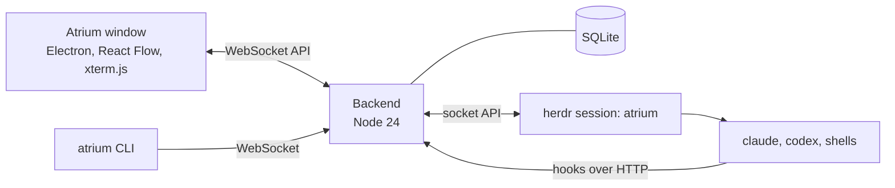

<p align="center">
  
</p>

<p align="center">
  <b>One infinite canvas for all your CLI coding agents.</b><br>
  See every Claude Code, Codex and shell session at once, know whose turn it is, and talk to them without switching windows.
</p>

<p align="center">
  
  
  
  
</p>

<p align="center">
  <b>English</b> · <a href="README.ko.md">한국어</a>
</p>


## Why

Running five agent CLIs in five terminal tabs works until one of them asks you a question and waits for twenty minutes. Atrium puts every session on one board. Each folder gets its own area, every session shows its live terminal and its state, and the ones that need you glow orange.

Atrium does not replace your agents or tell them how to work. It starts the sessions, connects them, and shows the connections. The agents still do the work, and they delegate to each other through [herdr](https://herdr.dev).

## Features

- **One board for every session.** Claude Code, Codex, DeepSeek (Claude Code through a local gateway) and plain shells live side by side. Each repository gets an area, and each live git worktree is a yellow box inside its repository's area. A folder that later becomes a git repository stays one area.
- **Launchers.** A launcher is a harness (Claude Code, Codex, ...) plus a model and options, or one command line you write yourself. Build them from dropdowns in one settings tab, star your favorites, and they sit on the left rail: one click starts a session.
- **Know whose turn it is.** Every session is *working*, *ready*, *your turn* or *error*, computed from herdr events and Claude Code hooks. The **Your turn** and **Review** queues, OS notifications and a tray badge tell you where to look. Answer an `AskUserQuestion` prompt from a card on the node.
- **Talk from the board.** Type `@name` (or `@all`) in the command bar. Each session has its own delivery queue, and every message is confirmed when the agent actually submits it.
- **Live terminals that zoom.** Every node is a real xterm.js terminal, and you can drag-select and copy at any zoom level. Zoom out and nodes turn into summary cards: name, state, pending question, last request, last answer. Click any node to fly to it.
- **Docks.** Snap sessions together into tmux-style split layouts, with layout presets for 2 to 7+ sessions. Links inside a dock show as small bridges on the dividers or short brackets along the outside, never as lines across your terminals.
- **Links between agents.** Draw a link from one session to another and give it a role, such as `worker` or `reviewer`. The agent learns how to hand work to that role through herdr, and the link lights up while work moves along it. Agents can also start child sessions (`atrium child`) with no limit on count or depth, and the board's `atrium` skill lets them split work across workers and git worktrees on their own. Child sessions appear as a tree.
- **Pick up old conversations.** Past Claude Code CLI conversations in an open folder show up as chat nodes that you can resume. Leftovers from test folders go to a *missed* list that you can clear in bulk.
- **Move over from the desktop app.** Import the sessions you haven't archived in the Claude desktop app in one go. Each one is opened as a fork under a new ID, so the app's copy is never touched, and lands asleep in its repository area until you click it. Importing again only picks up sessions that are new or that you kept using in the app.
- **Overviews.** A mission map of who directs whom, a list of changes since you last looked, and `Ctrl+F` search across sessions.
- **Notes on the canvas.** Markdown memos and kanban boards sit next to the sessions. Loops resend an instruction on a schedule or whenever a session goes idle.
- **Easy on memory.** A repository that has been idle for 30 minutes (configurable) goes to sleep and wakes up as a whole. Each node shows its memory use.
- **Keeps running.** Sessions live in herdr, so closing the window does not stop them. The board picks them back up when the window or the backend restarts.
- **Scriptable.** The `atrium` CLI and a local WebSocket API cover spawn, send, link, dock, kill and more.
- English and Korean UI. The Korean translation is by [Qualop](https://github.com/Qualop).

<table>
  <tr>
    <td width="50%"></td>
    <td width="50%"></td>
  </tr>
  <tr>
    <td align="center"><sub>A dock with links: the lead hands work to two workers.</sub></td>
    <td align="center"><sub>Your turn: answer the question right on the node.</sub></td>
  </tr>
</table>

## Requirements

Atrium is **Windows only** for now (Windows 10 or 11, x64).

| | |
|---|---|
| [Node.js](https://nodejs.org/) | 24.x |
| [herdr](https://herdr.dev) | Tested with 0.9.5 (protocol 22). Atrium finds herdr in the herdr install folder or on `PATH`. To use another file, set `ATRIUM_HERDR` or the herdr path in Settings. Other versions with protocol 22 work, with a warning. Without herdr the board still opens, but sessions cannot start. |
| [Claude Code](https://docs.anthropic.com/en/docs/claude-code) | A recent `claude` CLI on `PATH`. |
| Git | For repository and worktree detection. |
| Optional | Codex CLI for Codex sessions. An Anthropic-compatible gateway on `127.0.0.1:10100` (for example opencodex) for DeepSeek sessions. |

## Quick start

```powershell
git clone https://github.com/Gudals0320/atrium.git
cd atrium\backend
npm install
cd ..\app
npm install
npm run real
```

`npm run real` builds the window and opens the board. The window starts the backend if it is not running (port 47800), and the backend starts its own herdr session named `atrium`. Your other herdr sessions are not touched. Board data lives in `%LOCALAPPDATA%\atrium`.

To add a desktop shortcut:

```powershell
powershell -ExecutionPolicy Bypass -File app\scripts\make-shortcut.ps1
```

Then open a folder from the board and start a session from the left rail.

### Good to know

- Atrium never edits your `~/.claude/settings.json`. Each Claude Code session it starts gets its own settings file through `--settings`, which holds the hooks that report state back to the board.
- Atrium reads Claude Code conversation files under `%USERPROFILE%\.claude\projects` for the folders you open, so it can list and resume past conversations.
- Everything runs on your machine. The window talks to the backend on `127.0.0.1`, and the backend talks to herdr.
- Trust prompts ("Do you trust the files in this folder?") are left for you to answer. When an agent starts a worktree worker in a repository that Claude Code does not trust yet, the prompt appears on that worker's node.

## Remote access (Tailscale)

You can use the board from a laptop browser over [Tailscale](https://tailscale.com). The laptop does not see the PC screen; it opens the same board as a web page. The backend still listens only on `127.0.0.1`. `tailscale serve` on the PC ends HTTPS and passes requests from your tailnet to the board.

1. Install Tailscale on the PC and on the laptop, and log in to the same account on both.
2. In the tailnet admin console, open **DNS** and turn on **MagicDNS** and **HTTPS Certificates**. Machine names and the tailnet name are written to the public Certificate Transparency log when you do this.
3. On the PC, check and turn on serve:

   ```powershell
   node backend\bin\atrium.mjs remote status
   node backend\bin\atrium.mjs remote enable --yes
   ```

   `enable` runs `tailscale serve --bg --https=443 http://127.0.0.1:47800`. Without `--yes` it only prints the command. If another service already uses https 443, it stops and suggests a port (`--https-port 8443`). `remote guide` prints these steps.
4. On the laptop, open the address that `remote status` shows, for example `https://my-pc.example-tailnet.ts.net/`.
5. Pair the browser. On the PC window, open **Settings › Connected devices**, press **New code**, and type the 6-digit code on the laptop. Or ask for access from the laptop and allow it on the PC. The same tab shows the Tailscale check and the laptop address.
6. Create a passkey. Right after pairing, the laptop asks you to press **Create passkey** and confirm with Windows Hello, Touch ID or a security key. The device is added only after this step, and you have a few minutes to do it.
7. Optional: use the browser's **Install app** to open the board in its own window.

When the session ends, the laptop shows **Confirm it is you**: confirm with the same passkey and the board opens again. A session ends 12 hours after you sign in, or after 30 minutes with no connection (for example while the laptop sleeps). You can change both times in **Settings › Connected devices** on the PC. Passkeys work only on a secure page: open the board at its `https://…ts.net` address, or at `http://localhost:<port>` on the PC (not `127.0.0.1`).

Security notes:

- A paired browser has the same power as your Windows user on the PC. It can start a shell and run anything. Pair only your own devices.
- The browser keeps no password or token. The board stores only the public key of the passkey. After you confirm with the passkey, the session lives in an `HttpOnly; SameSite=Strict` cookie (`Secure` on https) that scripts on the page cannot read. The board keeps only a hash of the session ID.
- A paired browser works only from the Tailscale device it paired from. The board checks the requesting device with `tailscale whois` and refuses a session cookie or passkey signature that comes from a different Tailscale device. A browser paired on the PC itself (`localhost`) works only on the PC. The device list shows the device name that Tailscale confirmed in large text and the browser name in small text.
- Unpairing a device, or disconnecting it from the PC, ends all of its sessions at once and closes its open connections. A disconnected device must confirm with its passkey again to reattach. A browser can unpair only itself; disconnecting or renaming other devices is done on the PC.
- Browsers paired before passkeys (with a token) or before devices were bound to a Tailscale device cannot connect any more. They show **needs pairing again** in the device list. Remove them and pair the browser again.
- Requests that come through Tailscale are accepted only from the Tailscale user logged in on the PC. You can add other logins, or turn the check off, in **Settings › Connected devices** on the PC.
- Requests through Tailscale cannot call the hook and child-session endpoints, and the board API token is never given to a browser.
- Do not use `tailscale funnel`. Funnel puts the board on the public internet. `remote status` warns when funnel is on.
- You can see, disconnect and block remote connections from the PC.
  - The PC window shows a notice when a remote device attaches or pairs (also an OS notification when the window is hidden).
  - Click the **n other devices** pill at the top: each attached device has **Disconnect** (closes the connection and ends its session) and **Unpair**.
  - Turn off **Accept remote connections** in **Settings › Connected devices** (or in the tray menu, or run `node backend\bin\atrium.mjs remote block`) to refuse every paired device and every request through Tailscale and end all device sessions. The window and the CLI on this PC keep working. Run `remote allow` to accept them again.
  - Pairing, sign-ins, connects and disconnects, and refusals with their reason are kept in a connection log. See it in the same tab or with `node backend\bin\atrium.mjs remote log`.
- To unpair a device, press **Unpair** in **Settings › Connected devices**, or run `node backend\bin\atrium.mjs devices rm <id>`. To stop remote access (serve), run `node backend\bin\atrium.mjs remote disable --yes`.

## How it works



- **herdr** owns the terminals and processes. Sessions keep running when the window or the backend stops.
- **The backend** (`backend/`) computes session state from herdr events and Claude Code hooks, runs one delivery queue per session, records links and events, and stores the board in SQLite (`node:sqlite`). Its only dependency is `ws`.
- **The window** (`app/`) draws the board with React Flow and attaches xterm.js to the visible terminals.

## Development

```powershell
cd app
npm start            # dev profile: herdr session atrium-dev, port 47811, data in backend\.dev\
cd ..\backend
npm test             # backend unit tests
cd ..\app
npm test             # window unit tests
```

The development board never touches the real board (`atrium`, port 47800). End-to-end scripts in `app/test/e2e/` drive the window with Playwright on a separate dev board. See [docs/testing.md](docs/testing.md).

Design documents are in Korean:

- [docs/BRIEF.md](docs/BRIEF.md): why, what, decisions, usability principles, risks
- [docs/ARCH.md](docs/ARCH.md): processes, state model, features, modules, API, screens
- [docs/PLAN.md](docs/PLAN.md): current work and open decisions
- [docs/decisions.md](docs/decisions.md): how past decisions changed

## Status

Atrium is an early project. It was built in stages with Claude Code, and the interface is still being polished from daily use. Expect rough edges, and please open an issue when you hit one.

## Acknowledgments

- [herdr](https://herdr.dev), [React Flow](https://reactflow.dev), [xterm.js](https://xtermjs.org) and [Electron](https://www.electronjs.org).
- Korean UI translation by [Qualop](https://github.com/Qualop), adapted from [Qualop/atrium-macos](https://github.com/Qualop/atrium-macos).
- Fonts: Geist, JetBrains Mono, Pretendard and Nanum Gothic Coding, under the SIL Open Font License.
- Claude, Codex, DeepSeek, Grok and Pi names and logos are trademarks of their owners. Atrium uses them only to label session kinds and is not affiliated with or endorsed by them.

See [app/THIRD_PARTY_NOTICES.txt](app/THIRD_PARTY_NOTICES.txt) for details.

## License

[MIT](LICENSE) © 2026 Gudals0320
