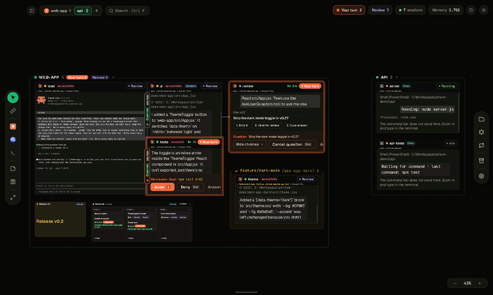
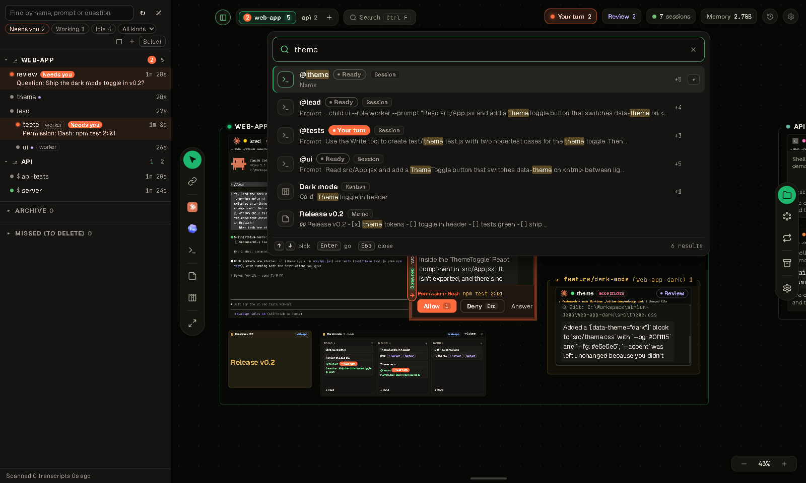
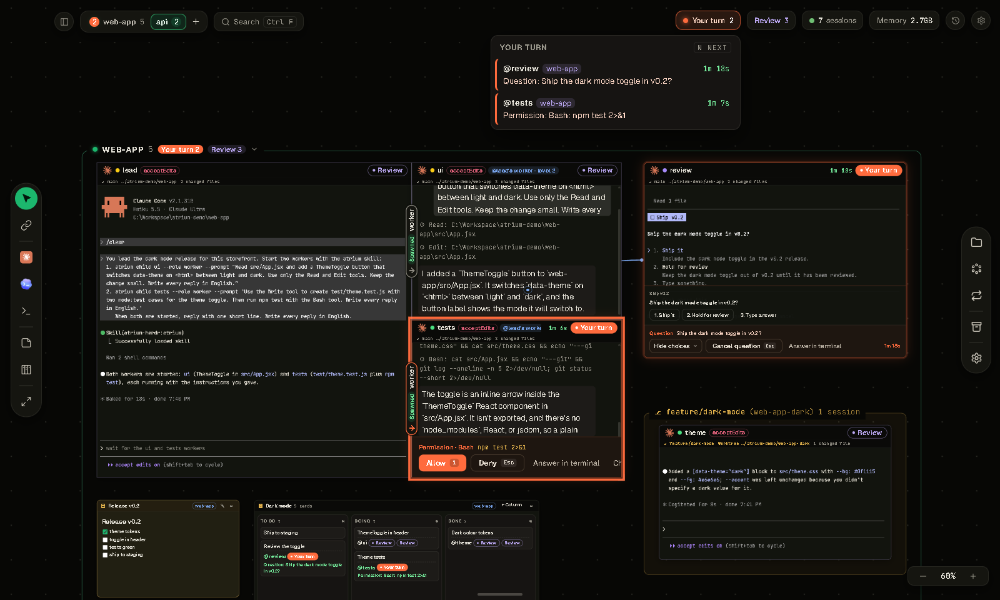
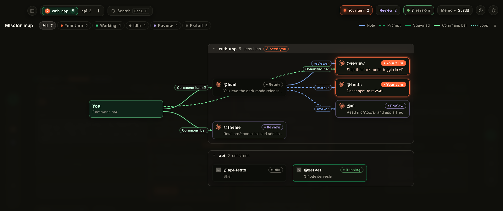
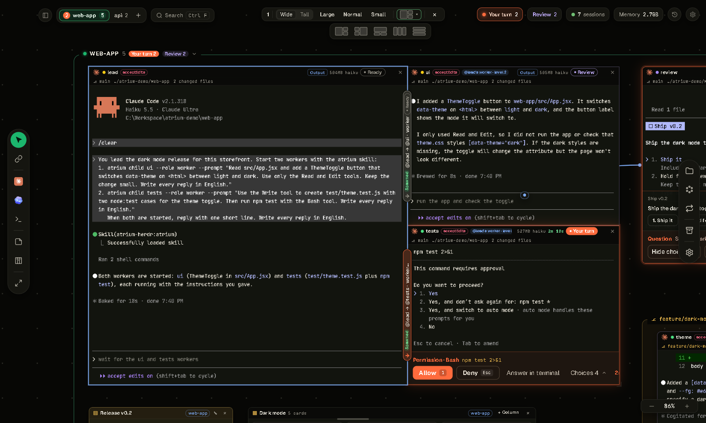
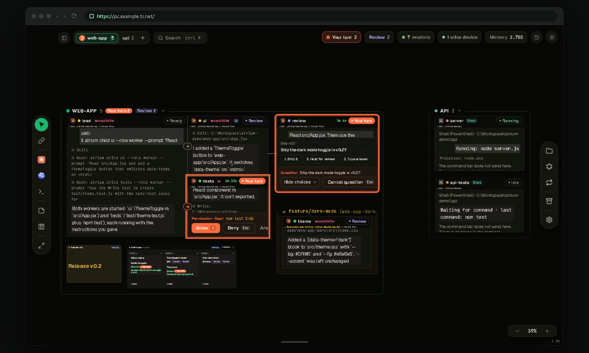
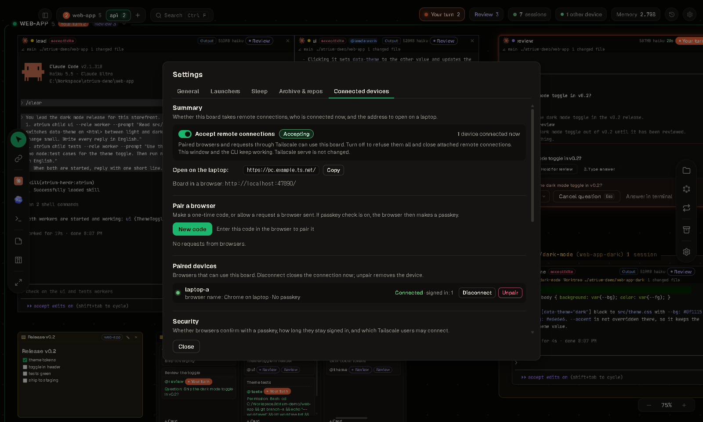
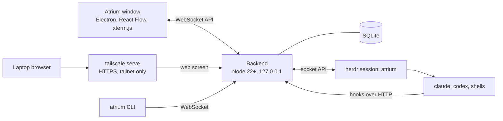

<p align="center">
  
</p>

<p align="center">
  <b>One infinite canvas for all your CLI coding agents.</b><br>
  See every Claude Code, Codex and shell session at once, know whose turn it is, and talk to them without switching windows.
</p>

<p align="center">
  
  
  
  
</p>

<p align="center">
  <b>English</b> · <a href="README.ko.md">한국어</a>
</p>



## What it is

Atrium is a Windows desktop app that puts every agent CLI session on one board. Each repository gets its own area, every session shows its live terminal and its state, working agents glow orange, and the sessions that need you glow yellow.

Atrium does not replace your agents or tell them how to work. It starts sessions, connects them and shows the connections. The agents do the work and hand it to each other through [herdr](https://herdr.dev), which also owns the terminals, so sessions keep running when the window closes.

## Features

### The board

- **Every session on one canvas.** Claude Code, Codex, other agents that herdr knows, and plain shells live side by side. Each repository is an area, and each live git worktree is a yellow box inside its repository's area.
- **Faces that follow the zoom.** Up close a node is its terminal. Further out it becomes a chat view, then a summary card: name, state, waiting question, last request and last answer. Click a node to fly to it.
- **Launchers.** A launcher is a harness plus a model and options, or one command line you write. Paste the command you already use (for example `ocx claude --model …`) and the board splits it into fields; a Claude Code launcher can use another start command and still runs as a full board session. Star it and it sits on the left rail: click it, type a session name (or leave it empty) and press Enter.
- **Sidebar and find.** The sidebar (`Ctrl+Shift+E`) is built for boards with 200+ sessions: virtual groups of repositories, filters by state and kind, and keyboard moves. `Ctrl+F` finds sessions by name, prompt, question or answer, plus memos and kanban cards.
- **Pick up old work.** Past Claude Code CLI conversations in an open folder appear as cards you can resume. Unarchived Claude desktop app sessions can be imported as forks, so the app's copy is never touched.
- **Easy on memory.** A repository that stays idle for 30 minutes (configurable) goes to sleep as a whole, and a session that stays idle for 30 minutes sleeps alone even while its repository is busy. Click a sleeping node to wake it: a repository that slept as a whole wakes as a whole, a session that slept alone wakes alone. Each node shows its memory use.



### Your turn

- **Know who is waiting.** Every session is *working*, *ready*, *your turn* or *error*, computed from herdr events and Claude Code hooks. Finished answers you have not looked at yet count as *Review*.
- **Answer in the terminal.** The board does not answer prompts for you. A waiting node turns yellow, joins the needs-you list and notifies you; click it (or press `N`) to land in its terminal. On a phone, a small key pad (arrows, Enter, Esc, Tab, Space, 1–4) opens when a session needs you and sends those keys to its terminal, for Claude Code, Codex and shells alike.
- **One list for all repositories.** The **Your turn** pill lists every waiting session, oldest first, and `N` jumps to the next one. OS notifications and the tray icon tell you when the window is in the background.
- **Changes since you looked.** Come back after a break and **Changes** sums up what each session did.



### Agents working together

- **Role links.** Draw a link from one session to another and give it a role, such as `worker` or `reviewer`. The agent learns how to hand work to that role through herdr, and the link lights up while work moves along it. Handoffs that agents make on their own through herdr are drawn too.
- **Workers on demand.** Agents start their own workers with `atrium child`, with no limit on count or depth. The board's `atrium` skill tells them when to split work across workers and git worktrees. Workers line up to the right of their parent in the order they were started, and show their parent, role and number in the header.
- **Models by name.** `atrium child --model "deepseek flash"` resolves a spoken model name against the models the board knows (`atrium models`), and model errors go back to the parent. A Claude Code session can start a Codex worker with `--kind codex`: it uses the rail's Codex launcher, model names with a slash such as `deepseek/deepseek-flash`, and the parent's permission mode as Codex approval flags.
- **Links you can read.** A session runs `atrium me` to see its parent, workers and role links as the board has them now, and gets a short notice when they change. Detach a session from its parent on the board, or start one with `atrium child --head` to lead its own work.
- **Mission map and Thread.** `M` opens a map of who directs whom: each workspace sits on a faint plate, teams flow left to right in small cards with model, effort and time, idle and asleep sessions are bordered pills, a light runs along the border of working cards in their state color so you can spot them from far away (it also runs around working nodes on the board; Settings › General › Working session light: On, Follow Windows, Off), thin unlabeled curves join a lead to its workers, two sessions linked both ways are joined by two short lines, a summary column lists who needs you and who is working, and pointing at a session keeps only its links. The phone map uses the same look in screen-width lanes. Thread keeps every prompt you sent from the command bar with its delivery state and the final report.
- **Talk from the board.** Type `@name` or `@all` in the command bar. Each session has its own delivery queue, and a message is confirmed only when the agent actually submits it. Loops resend a prompt on a schedule or whenever a session goes idle.



### Live terminals

- **Real terminals.** Every near node is an xterm.js terminal attached to the herdr pane, so you can type in it directly.
- **Select like a web page.** Drag to select at any zoom; the selection follows scrolling, scrolls at the edges and copies beyond the screen.
- **Paste that works.** Bracketed paste for agents, multi-line paste for shells.
- **Scale.** UI and terminal text scale from 70% to 150% (terminal text on phones down to 40%).
- **Output view.** Long answers open as Markdown on the side, where you can reply or save them as `.md`.

### Docks and layout

- **Docks.** `Ctrl`+drag a node onto another node's edge to split it, tmux style. Layout presets match the number of sessions (2 to 6, and even splits for 7 or more). Links inside a dock show as small bridges on the dividers, never as lines across your terminals.
- **Size and arrange.** Size steps (large, normal, small, wide, tall) for nodes and docks. **Arrange** lays out the board along the links and fits the whole board to the screen ratio, with one undo. Folders inside one another, or under one project folder, are grouped under one frame with relative path labels, and show as one chip in the top bar. Workspaces linked to each other by workers, roles or requests are placed side by side.
- **Notes on the canvas.** Markdown memos and kanban boards sit next to the sessions. A card linked to a session shows its state and takes you there.



### Remote access

- **The board in a browser.** Open the same board from a laptop over [Tailscale](https://tailscale.com). The backend still listens only on `127.0.0.1`; `tailscale serve` on the PC passes tailnet requests to it.
- **Pair with a code.** Press **New code** on the PC, or allow a request from the laptop. A paired browser is bound to the Tailscale device it paired from.
- **Passkey optional.** Off by default. Turn it on to confirm sign-ins with a phone or Windows Hello passkey.
- **Stay in control.** A connection log, attach notices, **Disconnect** and **Unpair** per device, and an **Accept remote connections** switch.
- **On a phone.** Added to the home screen, the board opens the session list and the mission map, and notifies you when a lead's whole work cycle ends (its workers included) or a session needs an answer (session name only, never the question). Worker alerts default to answers only.
- Each client keeps its own view. In the browser you can also pick PC folders and drop files into a terminal.

<table>
  <tr>
    <td width="50%"></td>
    <td width="50%"></td>
  </tr>
  <tr>
    <td align="center"><sub>The same board in a laptop browser.</sub></td>
    <td align="center"><sub>Connected devices on the PC.</sub></td>
  </tr>
</table>

English and Korean UI. The Korean translation is by [Qualop](https://github.com/Qualop).

## Requirements

Atrium is **Windows only** for now (Windows 10 or 11, x64).

| | |
|---|---|
| [Node.js](https://nodejs.org/) | 22.13 or later (tested on 22 and 24) |
| [herdr](https://herdr.dev) | Tested with 0.9.5 (protocol 22). Atrium finds herdr in the herdr install folder or on `PATH`; set `ATRIUM_HERDR` or the path in Settings to use another file. Other versions with protocol 22 work, with a warning. Without herdr the board still opens, but sessions cannot start. |
| [Claude Code](https://docs.anthropic.com/en/docs/claude-code) | A recent `claude` CLI on `PATH`. |
| Git | For repository and worktree detection. |
| Optional | Codex CLI for Codex sessions. An Anthropic-compatible gateway on `127.0.0.1:10100` (for example opencodex) for DeepSeek sessions. Tailscale for remote access. |

## Quick start

```powershell
git clone https://github.com/Gudals0320/atrium.git
cd atrium\backend
npm install
cd ..\app
npm install
npm run real
```

`npm run real` builds the window and opens the board. The window starts the backend if it is not running (port 47800), and the backend starts its own herdr session named `atrium`. Your other herdr sessions are not touched. Board data lives in `%LOCALAPPDATA%\atrium`.

To add a desktop shortcut:

```powershell
powershell -ExecutionPolicy Bypass -File app\scripts\make-shortcut.ps1
```

Then open a folder from the board and start a session from the left rail.

Keys on the board: `N` next session that needs you, `M` mission map, `Ctrl+F` or `↑` find, `↓` command bar, `←` `→` previous and next workspace, hold `Space` with nothing selected to fit the whole board, `Ctrl+Shift+E` sidebar, `Delete` close the selected sessions.

### Install and updates

To run a release instead of the cloned folder, install it from the clone (after `npm install` in `backend`):

```powershell
node backend\bin\atrium.mjs install
```

This puts the latest release into `%LOCALAPPDATA%\atrium\versions` and adds a desktop shortcut that opens the installed version. Board data stays in `%LOCALAPPDATA%\atrium`.

When a new release is out, the window tells you (Settings › General › Update, and the tray menu). Press Update to install it. Only the backend and the window restart. Your sessions keep running in herdr. If the new version does not start, the board goes back to the version you had.

The update channel is Stable by default. Pick Dev in the same place to get features merged into the `dev` branch first, as pre-releases. Dev builds may be less polished. `node backend\bin\atrium.mjs install --channel dev` installs the newest dev build.

### Good to know

- Atrium never edits your `~/.claude/settings.json`. Each Claude Code session it starts gets its own settings file through `--settings`, which holds the hooks that report state back to the board.
- Atrium reads Claude Code conversation files under `%USERPROFILE%\.claude\projects` for the folders you open, so it can list and resume past conversations.
- Everything runs on your machine. The window talks to the backend on `127.0.0.1`, and the backend talks to herdr.
- Trust prompts ("Do you trust the files in this folder?") are left for you to answer. When an agent starts a worktree worker in a repository that Claude Code does not trust yet, the prompt appears on that worker's node.

## Remote access (Tailscale)

1. Install Tailscale on the PC and the laptop and log in to the same account. In the tailnet admin console, turn on **MagicDNS** and **HTTPS Certificates** (machine and tailnet names then go to the public Certificate Transparency log).
2. On the PC, check and turn on serve:

   ```powershell
   node backend\bin\atrium.mjs remote status
   node backend\bin\atrium.mjs remote enable --yes
   ```

3. On the laptop, open the address that `remote status` shows, for example `https://my-pc.example-tailnet.ts.net/`.
4. On the PC, open **Settings › Connected devices**, press **New code**, and type the 6-digit code on the laptop. The board opens right away.

<details>
<summary><b>Details: serve, passkeys, security notes</b></summary>

**Serve.** `remote enable` runs `tailscale serve --bg --https=443 http://127.0.0.1:47800`. Without `--yes` it only prints the command. If another service already uses https 443, it stops and suggests a port (`--https-port 8443`). `remote guide` prints the steps. Instead of a code, you can also ask for access from the laptop and allow it on the PC. The browser's **Install app** opens the board in its own window.

**Confirm with a passkey** (**Settings › Connected devices › Security**, off by default) chooses how a paired browser signs in:

- **Off**: the paired browser opens the board directly from the Tailscale device it paired from, until you unpair it. On a personal laptop, the Tailscale device binding, the session cookie, the origin check and the attach notices already keep other devices out.
- **On**: right after pairing, the laptop asks you to press **Create passkey** and confirm on your phone (iPhone or Android, by scanning a QR code) or on this device (Windows Hello, Touch ID or a security key). When the session ends, the laptop shows **Confirm it is you**. A session ends 12 hours after you sign in, or after 30 minutes with no connection; you can change both times in the same tab. A passkey also stops someone who gets the laptop after a session ends; the Windows lock screen covers much of that too.
- When you turn it on, a browser that paired without a passkey shows **Add a passkey for this browser** the next time it connects. The device list shows **Passkey needed** until then. When you turn it off, live sessions last until unpair, and passkey records stay.
- Passkeys work only on a secure page: open the board at its `https://…ts.net` address, or at `http://localhost:<port>` on the PC (not `127.0.0.1`).

**Security notes.**

- A paired browser has the same power as your Windows user on the PC. It can start a shell and run anything. Pair only your own devices.
- The browser keeps no password or token. The session lives in an `HttpOnly; SameSite=Strict` cookie (`Secure` on https) that scripts on the page cannot read. The board keeps only a hash of the session ID, and only the public key of a passkey.
- A paired browser works only from the Tailscale device it paired from: the board checks the requesting device with `tailscale whois`. A browser paired on the PC itself (`localhost`) works only on the PC. Browsers paired before devices were bound (or with an old token) show **needs pairing again**; remove them and pair again.
- Requests through Tailscale are accepted only from the Tailscale user logged in on the PC (you can add other logins in **Connected devices**). They cannot call the hook and child-session endpoints, and the board API token is never given to a browser.
- Do not use `tailscale funnel`, which puts the board on the public internet. `remote status` warns when funnel is on.
- The PC window shows a notice when a device attaches or pairs. The **n other devices** pill has **Disconnect** and **Unpair** for each device; a browser can unpair only itself. Turning off **Accept remote connections** (Settings, the tray menu, or `remote block`) refuses every paired device and closes their connections; `remote allow` accepts them again. With the passkey check on, disconnecting or blocking also ends sessions.
- Pairing, sign-ins, connects and disconnects, passkey check changes and refusals with their reason are kept in a connection log (`remote log`).
- To unpair from the CLI, run `node backend\bin\atrium.mjs devices rm <id>`. To stop serve, run `node backend\bin\atrium.mjs remote disable --yes`.

</details>

## CLI

The `atrium` CLI talks to the running backend. Run it as `node backend\bin\atrium.mjs <command>`; `--help` lists everything.

| Command | Does |
|---|---|
| `spawn <folder> [--launcher l] [--name n] [--model m] [--kind shell]` | Start a session |
| `ls`, `inbox`, `get <name>` | Sessions and their state, what needs you, one session in detail |
| `send @name [@name…] <text> [--wait]` | Send a message (`@all` for every agent) |
| `answer <name> <n\|reject>` | Answer a permission prompt or question |
| `link <a> <b> --role worker` | Link two sessions with a role |
| `dock <a> <b>`, `dock layout <preset> <a> <b> …` | Dock sessions, lay out a dock |
| `arrange --all --apply` | Arrange the whole board |
| `kill <name> --yes` | Close a session |
| `remote status`, `remote log`, `devices` | Remote access, connection log, paired devices |

Sessions the board starts also get `atrium child`, `atrium children` and `atrium models` for their own workers, and `atrium me` for their links.

## How it works



- **herdr** owns the terminals and processes. Sessions keep running when the window or the backend stops, and the board picks them back up when it restarts.
- **The backend** (`backend/`) computes session state from herdr events and Claude Code hooks, runs one delivery queue per session, records links and events, serves the web screen, and stores the board in SQLite (`node:sqlite`). Its only dependency is `ws`.
- **The window** (`app/`) draws the board with React Flow and attaches xterm.js to the terminals in view. The PC window and paired browsers are all clients of the same backend.

## Development

```powershell
cd app
npm start            # dev profile: herdr session atrium-dev, port 47811, data in backend\.dev\
cd ..\backend
npm test             # backend unit tests
cd ..\app
npm test             # window unit tests
```

The development board never touches the real board (`atrium`, port 47800). End-to-end scripts in `app/test/e2e/` drive the window with Playwright on a separate dev board. The pictures in this README come from a demo board built by `app/test/e2e/readme-shots.mjs` (`seed`, `shoot`, `publish`, `clean`).

[CHANGELOG.md](CHANGELOG.md) lists what each stage built.

## Status

Atrium is an early project. It was built in stages with Claude Code, and the interface is still being polished from daily use. Expect rough edges, and please open an issue when you hit one.

## Acknowledgments

- [herdr](https://herdr.dev), [React Flow](https://reactflow.dev), [xterm.js](https://xtermjs.org) and [Electron](https://www.electronjs.org).
- Korean UI translation by [Qualop](https://github.com/Qualop), adapted from [Qualop/atrium-macos](https://github.com/Qualop/atrium-macos).
- Fonts: Geist, JetBrains Mono, Pretendard and Nanum Gothic Coding, under the SIL Open Font License.
- Claude, Codex, DeepSeek, Grok and Pi names and logos are trademarks of their owners. Atrium uses them only to label session kinds and is not affiliated with or endorsed by them.

See [app/THIRD_PARTY_NOTICES.txt](app/THIRD_PARTY_NOTICES.txt) for details.

## License

[MIT](LICENSE) © 2026 Gudals0320. Third-party logos and fonts are not under the MIT license; see [app/THIRD_PARTY_NOTICES.txt](app/THIRD_PARTY_NOTICES.txt).
