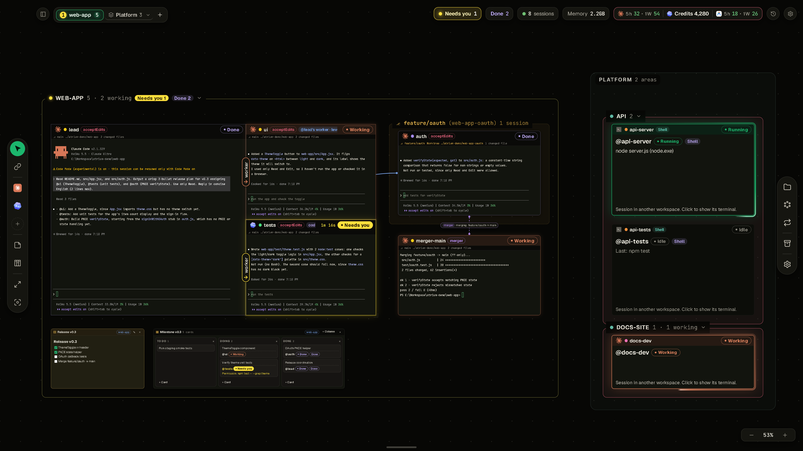
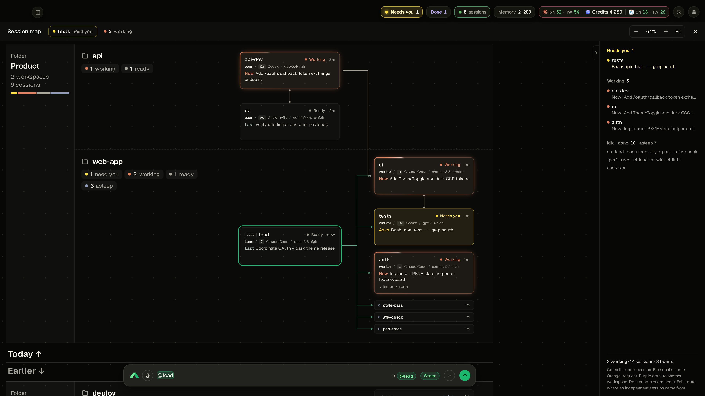
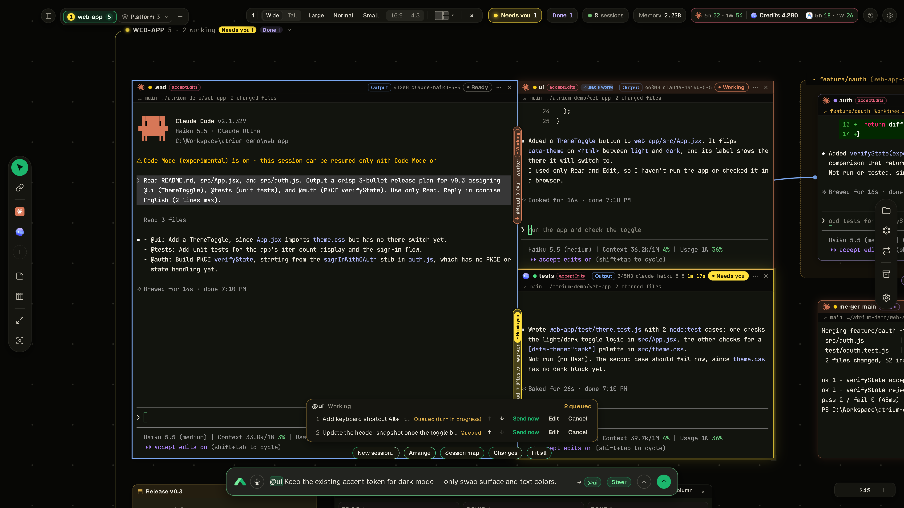
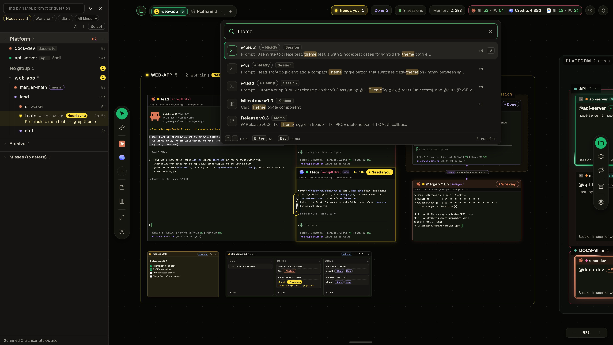
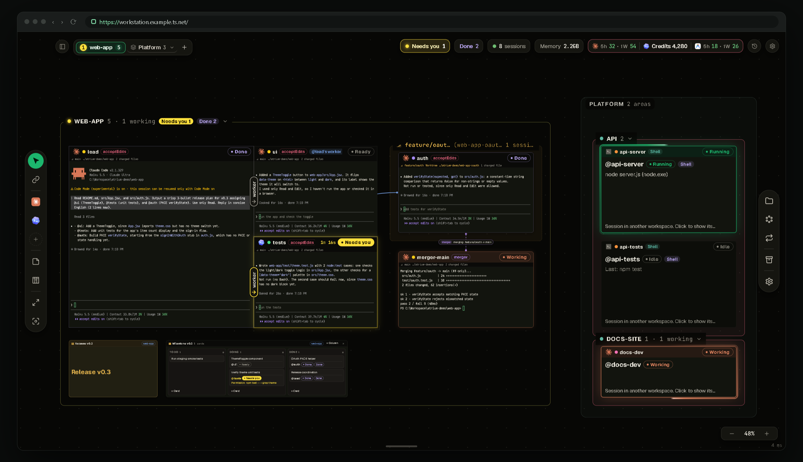
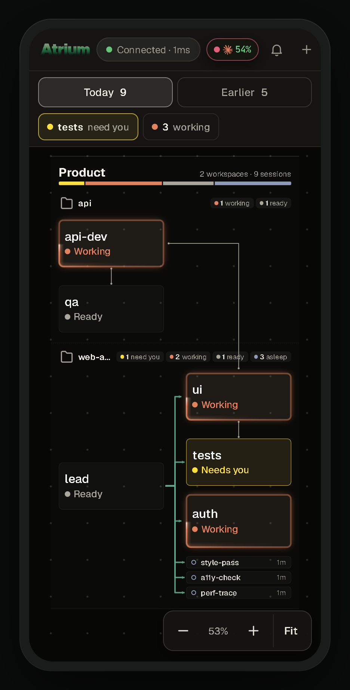
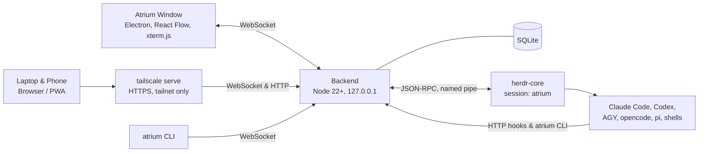

<p align="center">
  
</p>

<p align="center">
  <b>An infinite canvas for your CLI coding agents.</b><br>
  Run Claude Code, Codex, Antigravity, opencode, pi, and shells on one spatial board — see who is working, who needs you, and coordinate them without switching windows.
</p>

<p align="center">
  
  
  
  
</p>

<p align="center">
  <b>English</b> · <a href="README.ko.md">한국어</a>
</p>



## Why Atrium

Running five or twenty coding agents in parallel breaks down fast in tabs and scrolling sidebars: every list reorders on activity, background sessions disappear, and you miss the one prompt waiting for approval.

Atrium gives every repository and live terminal a fixed place on one infinite canvas. Working agents glow orange, sessions waiting for you glow yellow, and every terminal runs outside the app inside [herdr-core](https://github.com/herdrdev/herdr-core). Close the window, restart the backend, or update Atrium — your sessions keep running and reattach when you come back.

## A quick tour

### One canvas for every repo

Each repository gets its own region, and active git worktrees appear as yellow boxes inside it. Up close, every node is a live `xterm.js` terminal you can type in directly. Zoom out and nodes simplify into status cards with their latest prompt and reply.

The top bar stays consistent across all repositories:

- **Needs you** (`N`) jumps straight to the oldest waiting prompt.
- **Done** collects finished top-level turns you have not viewed yet, with **Mark all read**.
- **Usage** tracks local Claude, Codex (including remaining credits), and Antigravity quota windows.
- **Memory & CPU** shows per-session and system usage; idle repos and idle sessions automatically sleep to free RAM and wake on click or message with the same conversation, model, and effort level.

Markdown memos and session-linked kanban boards sit right next to your terminals.

### Session Map (`Tab`)



Press `Tab` to switch from the canvas to the **Session Map** — an infinite lineage view organized by folder and repository, split into **Today** and **Earlier**.

- Follow parent–worker trees and peer chains across Claude Code, Codex, Antigravity, and pi without crossing lines.
- Spot running sessions from afar by their animated border light, while sleeping workers collapse into compact rows.
- Click any card to `@tag` it directly in the bottom command bar and send a prompt without leaving the map, or double-click to jump to its terminal.

### Docks, delivery queues, and mid-turn steering



- **Docks.** `Ctrl`+drag any terminal onto another node's edge to split it tmux-style, switch presets for 2–6+ panes, and keep links as clean divider bridges instead of lines across your screen.
- **Per-session delivery queue.** Send messages to `@name` or `@all` from the command bar (`Ctrl+K` or `↓`). Prompts queue while an agent is busy and submit cleanly once its turn ends. Reorder, edit, or cancel queued messages at any time.
- **Steer mid-turn.** Toggle **Steer** (or press `Ctrl+Enter`) to inject guidance into a running Claude Code turn immediately instead of waiting in the queue.
- **Answer in the terminal.** Atrium does not wrap prompts in brittle modal cards — click a yellow session (or press `N`) and reply directly in the real terminal.

### Sidebar & Quick Find for large boards



- **Collapsed folders keep active work visible.** Toggle the sidebar (`Ctrl+Shift+E`) to navigate virtual repo groups and hundreds of sessions. Even when a folder or repo is collapsed, **working and needs-you sessions stay pinned underneath** so nothing running slips out of view.
- **Quick Find (`Ctrl+F`).** Search sessions by name, prompt, question, or reply — plus memos and kanban cards.
- **Resume past work.** Unattached Claude Code and Codex CLI conversations appear per repo so you can bring them onto the board in one click.

### Multi-agent handoffs & Auto-Merger

Every agent Atrium starts — **Claude Code, Codex, Antigravity (AGY), opencode, or pi** — gets the same `atrium` command on `PATH`, regardless of harness:

```powershell
atrium child ui --worktree ui --prompt "Build the ThemeToggle component"
atrium child api-dev --peer --prompt "Add /oauth/callback endpoint"
atrium prompt ui "Keep the existing accent color" --steer
atrium done ok "Added ThemeToggle and unit tests (all passing)"
```

- **Structured delegation.** Workers close their task with `atrium done ok|failed "<report>"`, delivering the result back to their parent once — no polling loops. Peers stay independent and share updates via `atrium news` and `atrium log`.
- **Auto-Merger (`Settings › Merger`).** When a worktree worker finishes with `atrium done ok`, Atrium can sleep the worker and hand its branch to a dedicated, low-context **merger** session that merges cleanly into your target branch and reports back only if a failure or decision needs the parent. Configure per project (`On`, `Ask`, or `Off`, plus `.atrium/merge.json`).
- **Board doc checks (`atrium docs`).** Optional, non-blocking checks that keep project docs within size and structure budgets on each turn.

### Remote & mobile over Tailscale

<table>
  <tr>
    <td width="68%" valign="top"></td>
    <td width="32%" valign="top"></td>
  </tr>
  <tr>
    <td align="center"><sub>Same board in a laptop browser over Tailscale.</sub></td>
    <td align="center"><sub>Phone PWA opens straight to the Session Map.</sub></td>
  </tr>
</table>

Open the exact same board from a laptop or phone over [Tailscale](https://tailscale.com). The backend stays bound to `127.0.0.1`; `tailscale serve` forwards tailnet HTTPS traffic to it.

- **Pair with a 6-digit code** in **Settings › Connected devices** (or approve a request from the browser). Sessions are bound to the paired Tailscale device via `tailscale whois`, with an optional passkey check (Windows Hello or phone).
- **On a phone (PWA),** Atrium opens straight into the **Session Map** with **Today | Earlier** tabs, a representative usage pill, a touch keypad (arrows, Enter, Esc, Tab, Space, 1–4) for answering prompts in any harness, and Web Push alerts when a lead's work cycle ends or a session needs you.

<details>
<summary><b>Tailscale setup & security notes</b></summary>

1. Install Tailscale on both devices, sign in to the same tailnet, and enable **MagicDNS** and **HTTPS Certificates** in your Tailscale admin console.
2. Enable `tailscale serve` on the PC:

   ```powershell
   node backend\bin\atrium.mjs remote status
   node backend\bin\atrium.mjs remote enable --yes
   ```

3. Open the `https://<machine>.<tailnet>.ts.net/` URL printed by `remote status` on your laptop or phone, then pair with a code from **Settings › Connected devices**.

**Security notes:**
- A paired browser has the same local privileges as your Windows user. Pair only your own devices.
- Sessions use `HttpOnly; SameSite=Strict` cookies (`Secure` on HTTPS); no permanent token is stored in the browser.
- Requests are verified against `tailscale whois` and restricted to your Tailscale login by default. Do not use `tailscale funnel`.
- Manage or revoke devices anytime in **Settings › Connected devices**, the tray menu, or `node backend\bin\atrium.mjs remote block | devices rm <id> | remote disable --yes`.

</details>

## Quick start

### Requirements

Atrium currently runs on **Windows 10 / 11 (x64)**.

| Dependency | Details |
|---|---|
| [Node.js](https://nodejs.org/) | 22.13 or later (tested on 22 and 24) |
| [herdr-core](https://github.com/herdrdev/herdr-core) | Auto-downloaded on first run (pinned `0.1.20`, ~4 MB, SHA-256 verified) into Atrium's data folder. Does not touch `PATH` or startup items. |
| Git | Used for repository and worktree detection. |
| Agent CLIs | Any supported CLI on `PATH`: [Claude Code](https://docs.anthropic.com/en/docs/claude-code), Codex, Antigravity (`agy`), opencode, or pi. |
| Optional | [Tailscale](https://tailscale.com) for remote laptop & phone access. |

### Run from source

```powershell
git clone https://github.com/Gudals0320/atrium.git
cd atrium\backend
npm install
cd ..\app
npm install
npm run real
```

`npm run real` builds the window and opens the board (starting the backend on port `47800` and downloading `herdr-core` on first run). Click **+** at the top left to open a repository, then pick a launcher on the left rail to start a session.

Create a desktop shortcut:

```powershell
powershell -ExecutionPolicy Bypass -File app\scripts\make-shortcut.ps1
```

### Install releases & in-app updates

Install the latest GitHub release into `%LOCALAPPDATA%\atrium\versions` (after `npm install` in `backend`):

```powershell
node backend\bin\atrium.mjs install
# Or track pre-release builds from the dev branch:
node backend\bin\atrium.mjs install --channel dev
```

When a new release is available, update from **Settings › General › Update** or the tray menu. Only the backend and window restart — running terminals stay alive in `herdr-core`, and failed starts roll back automatically.

### Keyboard shortcuts

| Key | Action |
|---|---|
| `Tab` | Toggle Session Map |
| `N` | Jump to next session that needs you |
| `Ctrl+K` / `↓` | Focus command bar |
| `Ctrl+Enter` | Send as Steer (mid-turn) from command bar |
| `Ctrl+F` / `↑` | Open Quick Find |
| `Ctrl+Shift+E` | Toggle sidebar |
| `←` / `→` | Previous / next workspace |
| Hold `Space` | Fit entire board (when nothing is selected) |
| `Delete` | Close selected sessions |

<details>
<summary><b>Upgrading from Atrium 0.1.7 or earlier (herdr migration)</b></summary>

Boards that previously ran on [herdr](https://herdr.dev) migrate automatically to `herdr-core` on first start. Idle sessions move right away with their conversation, layout, and links intact; busy sessions wait until idle. Progress is shown in **Settings › Terminal**.

</details>

## CLI & architecture

Run `node backend\bin\atrium.mjs <command>` to drive the board from any terminal (`--help` lists every verb):

| Command | Purpose |
|---|---|
| `spawn <folder> [--launcher l] [--name n] [--model m] [--kind shell]` | Start a session |
| `ls`, `inbox`, `get <name>` | List sessions, waiting prompts, or full session detail |
| `send @name [@name…] <text> [--wait]` | Queue a prompt (`@all` targets every agent) |
| `link <a> <b> --role worker` | Link two sessions with a role |
| `dock <a> <b>`, `dock layout <preset> <a> <b> …` | Dock panes and apply split layouts |
| `arrange --all --apply` | Auto-arrange the board along links |
| `usage`, `res`, `docs` | Check subscription usage, memory/CPU, and board doc checks |
| `remote status`, `remote log`, `devices` | Manage Tailscale remote access |
| `kill <name> --yes` | Close a session |

Inside any board-started agent session, `atrium` is automatically on `PATH` with `prompt`, `wait`, `read`, `child`, `children`, `relate`, `done`, `item`, `items`, `me`, `news`, `log`, `models`, `usage`, `docs`, and `help --json`.



- **herdr-core** owns all terminals and child processes outside Atrium, so sessions survive restarts and updates.
- **Backend** (`backend/`) tracks session state, per-session delivery queues, links, work units, usage, remote web serving, and SQLite (`node:sqlite`) with only one npm dependency (`ws`).
- **Window** (`app/`) renders the canvas and Session Map with React Flow and attaches `xterm.js` to visible terminals.

## Development

```powershell
cd app
npm start            # dev profile: herdr-core session atrium-dev, port 47811, data in backend\.dev\
cd ..\backend
npm test             # backend unit tests
cd ..\app
npm test             # window unit tests
```

The dev profile is isolated from your real board (`atrium`, port `47800`). Screenshots in this README are generated against an isolated demo board by `app/test/e2e/p273-readme-shots.mjs` (`seed`, `shoot`, `publish`, `clean`).

See [CHANGELOG.md](CHANGELOG.md) for full stage-by-stage history. Atrium is an active early project — bug reports and issues are welcome.

## Acknowledgments

- [herdr-core](https://github.com/herdrdev/herdr-core) (Apache-2.0, downloaded at runtime and not bundled in this repository) and [herdr](https://herdr.dev).
- [React Flow](https://reactflow.dev), [xterm.js](https://xtermjs.org), and [Electron](https://www.electronjs.org).
- Korean UI translation by [Qualop](https://github.com/Qualop), adapted from [Qualop/atrium-macos](https://github.com/Qualop/atrium-macos).
- Bundled fonts: Geist, JetBrains Mono, Pretendard, and Nanum Gothic Coding (SIL Open Font License 1.1).
- Claude, Codex, Antigravity, DeepSeek, Grok, and Pi names and logos are trademarks of their respective owners, used solely to label session kinds with no affiliation or endorsement.

See [app/THIRD_PARTY_NOTICES.txt](app/THIRD_PARTY_NOTICES.txt) for full third-party notices.

## License

[MIT](LICENSE) © 2026 Gudals0320. Third-party logos and fonts remain under their respective licenses; see [app/THIRD_PARTY_NOTICES.txt](app/THIRD_PARTY_NOTICES.txt).
